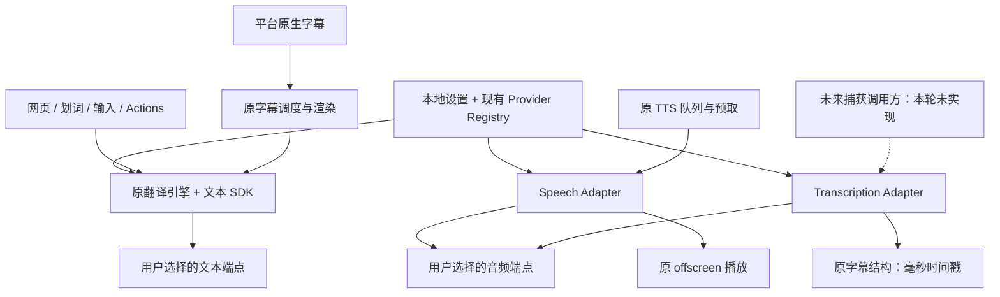

# Read Frog Lite

**Read Frog Lite 0.2.4 是一个使用用户自有服务的 Chromium Manifest V3 翻译扩展。** 基于 [Read Frog v1.54.1](https://github.com/mengxi-ream/read-frog/tree/aa6d54d1b9fde901fa7dbc00540a196fd28cd388)，保留成熟的翻译实现，移除官方账户、订阅、Hosted AI、云同步和遥测。它是独立修改版，与 Read Frog 官方发行版无关。

普通使用者可以直接下载扩展安装包，**不需要下载源码或在个人电脑编译**。翻译、语音合成和语音转录服务均由用户选择；扩展不提供内置免费额度，也不通过 Read Frog 官方服务器中转请求。

[直接下载 v0.2.4 扩展 ZIP](https://github.com/poohyeban/read-frog/releases/download/v0.2.4/read-frog-lite-0.2.4-chrome.zip) · [Releases](https://github.com/poohyeban/read-frog/releases) · [验收 CI](https://github.com/poohyeban/read-frog/actions/workflows/pr-test.yml) · [重构报告](docs/restore/REPORT.md) · [人工验收步骤](docs/restore/MANUAL-ACCEPTANCE.md)

0.2.4 修复 YouTube 网站 Service Worker 与扩展动态模块加载产生的资源报错、没有接收端时的后台消息错误，并补齐字幕启动期间的失效处理。保留 0.2.3 的长字幕翻译和 AI 断句时间轴修复，以及内置 DeepSeek 和本地图标。详见[本版说明](docs/restore/RELEASE-0.2.4.md)。

## 目录

- [功能与当前边界](#功能与当前边界)
- [安装、升级与备份](#安装升级与备份)
- [配置翻译、TTS 与 ASR 服务](#配置翻译tts-与-asr-服务)
- [日常使用](#日常使用)
- [本地数据、网络与权限](#本地数据网络与权限)
- [开发环境与常用命令](#开发环境与常用命令)
- [代码目录与调用关系](#代码目录与调用关系)
- [如何继续开发与同步上游](#如何继续开发与同步上游)
- [CI、构建产物与版本更新](#ci构建产物与版本更新)
- [常见问题](#常见问题)
- [来源、许可证与工程记录](#来源许可证与工程记录)

## 功能与当前边界

| 功能     | 当前实现                                                                                        |
| -------- | ----------------------------------------------------------------------------------------------- |
| 网页翻译 | 全文、双语、仅译文、原文恢复、动态 DOM 处理、站点规则、自定义 Prompt、本地缓存；沿用原翻译引擎  |
| 文字辅助 | 划词翻译、基本 AI 解释、输入框翻译、悬停段落翻译、浮动按钮、快捷键                              |
| 本地工具 | 术语表及 CSV 导入导出、自定义 AI Actions、翻译中心；数据本地保存                                |
| 视频字幕 | 恢复 YouTube、Netflix、X 的原生字幕适配、翻译、同步、双语 / 仅译文、侧栏、样式和 SRT 导出       |
| TTS 朗读 | 恢复分段、播放队列、预取、缓存、停止 / 替换、语速和按语言选择 Voice；使用用户配置的 Speech 服务 |
| ASR 转录 | 已实现音频 Blob 到识别文本 / 可选时间片段的适配器、配置、取消、超时和响应校验；没有网页捕获入口 |

明确的边界：

- 不恢复登录、OAuth、Session、Billing、Pro / Ultra、官方配额、Hosted AI、Notebase、FSRS、学习账户、推广或遥测。
- 不默认调用 Edge 在线 TTS，没有隐式备用服务。未配置 Speech / ASR 时提示配置。
- 视频字幕目前依赖平台原生字幕。**没有视频音频捕获、无字幕视频自动 ASR、实时流式转录或内置模型部署。**
- 原版 TTS 没有独立的暂停后继续 API，本版保留停止 / 再播放，没有另造暂停恢复机制。
- 自定义 Action 保留基础字段输出和本地图标；没有恢复许可未确认的专有布局引擎和在线布局生成器。

验证范围：生产代码已通过类型 / Lint、269 个测试文件中的 2601 项单元和协议测试，以及真实 Chromium 的网页双语、仅译文、恢复、划词、输入翻译、配置持久化和网络隔离回归。字幕另有真实生产扩展回归，覆盖连续翻译、长字幕跳转、重载恢复和 AI 时间轴校验。浏览器测试调用本地 HTTP 测试端点、使用可控页面，不证明任何真实模型的翻译质量。YouTube / Netflix / X 当前网页、复杂编辑器、真实音频设备和具体模型部署仍需按[人工验收步骤](docs/restore/MANUAL-ACCEPTANCE.md)检查。

## 安装、升级与备份

### 首次安装：无需编译

1. 打开本 Fork 的 [Releases](https://github.com/poohyeban/read-frog/releases)，选择所需版本，或使用上方的直接下载链接。
2. 下载 Assets 中的 **`read-frog-lite-0.2.4-chrome.zip`**。不要下载 `Source code` 作为安装包，那是源码。附件 `SHA256SUMS.txt` 用于校验。
3. 解压扩展 ZIP，将扩展目录保存在固定位置。Release 下载不受 Actions Artifact 的 30 天保留期限制。
4. Chrome 打开 `chrome://extensions`，Edge 打开 `edge://extensions`，开启开发者模式，选择“加载已解压的扩展程序”。
5. 选择**直接包含 `manifest.json` 的目录**，确认名称为 Read Frog Lite。打开扩展设置配置服务，再刷新要翻译的网页。

开发中的未发布版本仍可从 [Actions](https://github.com/poohyeban/read-frog/actions/workflows/pr-test.yml) 下载 `read-frog-lite-chromium-<commit>` Artifact。Artifact 需要先解压外层，再解压里面的扩展 ZIP；GitHub 可能要求登录才能下载 Artifact，扩展本身不需要 Read Frog 账户。请确认该运行的全部检查通过。

当前以 Chromium MV3 为目标；没有在本轮验证 Firefox。浏览器内置页、扩展商店等受保护页面不能像普通网页一样注入翻译脚本。

### 更新已有安装

1. 先导出本地配置，并单独导出需要保留的术语表 CSV。默认配置导出不含 Key / 自定义请求头；如果选择包含密钥，妥善保存且不要提交到 Git。
2. 将新安装包解压到临时目录，检查其中的 `manifest.json` 和版本。
3. 用新文件完整替换原扩展目录的文件，保留原目录路径，在原扩展条目点击“重新加载”，然后刷新已打开网页。
4. 确认扩展 ID 没变，检查语言、Provider、模型和术语表仍在。不要通过卸载重装升级，也不要同时启用两份 Lite。

Lite 0.1 的本地配置会补齐新增字段，音频服务初始为空。卸载、更换扩展 ID、清除浏览器数据可能丢失本地配置。配置导出不是整个 IndexedDB 的备份，翻译缓存可以重新生成，术语表应单独导出。

`codex/read-frog-lite` 保留 0.1 基线，便于代码比较。**源码可回退不代表新数据库可直接降级**：0.2 已升级数据库和配置结构，回退前应备份，不要让旧版直接接管唯一一份新数据。

## 配置翻译、TTS 与 ASR 服务

### 先理解两层配置

1. **API Providers** 保存一个服务的类型、名称、Base URL、API Key、自定义请求头和文本模型。
2. 各功能再选择要使用哪个 Provider。网页、划词、输入、字幕、Speech 和 Transcription 可以分别选择；音频模型在各自音频设置页独立填写。

同一服务器可以复用一个 Provider；不同端点或不同鉴权应创建不同 Provider。删除被选 Provider 会清空相关功能的选择，不自动切换到其他网络服务。禁用 Provider 会阻止调用，但保留配置。

### 文本翻译

| Provider 类型                                            | 适用服务 / 地址说明                                                                                               |
| -------------------------------------------------------- | ----------------------------------------------------------------------------------------------------------------- |
| OpenAI                                                   | 使用已有 OpenAI SDK；保留原 Responses 路径。仅支持 Chat Completions 的第三方服务应选兼容类型                      |
| DeepSeek                                                 | 使用专用 DeepSeek SDK，默认地址 `https://api.deepseek.com`，支持自定义地址 / Key / 模型；结构化操作使用 JSON mode |
| OpenAI-compatible（界面也可能显示 Custom Chat Complete） | 使用 Chat Completions；例如 `http://127.0.0.1:8000/v1`，最终请求为 `/v1/chat/completions`                         |
| Google Gemini                                            | 使用原 Gemini SDK 和该协议的 Base URL，不使用 OpenAI 的路径格式                                                   |
| Ollama                                                   | 使用原 Ollama SDK；填写目标 Ollama 服务地址和已经安装的模型名称                                                   |

配置步骤：

1. 添加或编辑 Provider，启用它，填写目标服务的 Base URL 和实际模型名称。模型不在列表时选择自定义模型。
2. 服务需要鉴权时填写自己的 Key；无鉴权本地服务可留空。不要把 Key 写在 URL、Prompt 或源码中。
3. 在各功能的 Provider 选择中指定服务，设置源语言与目标语言，再执行一次翻译。
4. 需要时主动使用模型发现 / 连接测试；服务可能不支持模型列表，仍可手工填写模型。

对于 OpenAI-style 服务，Base URL 通常包含 `/v1`，**不要填写完整的 `/chat/completions`、`/audio/speech` 或 `/audio/transcriptions` 地址**。`localhost` 指运行浏览器的电脑，不是构建扩展的云端机器；模型在另一台电脑时应填写其局域网地址。

### DeepSeek 配置、升级与费用

新配置选择 **DeepSeek**，填入自己的 Key，模型可选 `deepseek-flash`；开启“自定义模型”后也可使用“获取可用模型”或手动填写。专用 SDK 用 `json_object` 并在提示词中加入结构要求，扩展仍校验模型返回字段，不能把任意 JSON 当作有效结果。

从旧版升级时，配置版本 5 会一次性转换使用 `https://api.deepseek.com` 标准根路径或 `/v1` 的 Custom Chat Complete 配置。已有 ID、名称、Key、headers、实际模型、请求选项和功能绑定保留。带账号密码、查询参数、fragment、自定义端口或其他路径的地址，以及第三方代理不会自动转换；这些配置需由使用者按真实协议选择 Provider。升级后重新加载扩展并刷新网页。新建配置或导入旧备份时，应明确选择 DeepSeek，勿继续用通用类型承载不支持 JSON Schema 的服务。

`@ai-sdk/deepseek` 3.0.63 是 Vercel AI SDK 的 Apache-2.0 开源包，SDK 本身免费。[包许可证](https://cdn.jsdelivr.net/npm/@ai-sdk/deepseek@3.0.63/LICENSE)、[完整许可文本](LICENSES/Apache-2.0.txt)与第三方版权声明随扩展分发。DeepSeek API 调用仍由 DeepSeek 按其服务规则计费；SDK 不包含免费模型额度，也不增加 Read Frog / Vercel 中转服务。请求直接发送到你配置的地址。

### GPT 是否需要另一套适配器

选择 OpenAI 已使用 `@ai-sdk/openai`；本项目走 Responses API，结构化操作由 SDK 生成 `text.format.type = json_schema`。受支持的 OpenAI 模型原生支持 Structured Outputs，无需再加适配器。它能约束字段结构，而 `json_object` 只保证 JSON 格式；旧模型或第三方“GPT”兼容端点不能仅凭名称推断支持情况。参见 [OpenAI Structured Outputs](https://developers.openai.com/api/docs/guides/structured-outputs)。

### TTS：文本 → 音频播放

1. 在 API Providers 配置 OpenAI 或 OpenAI-compatible 服务。
2. 在语音 / Text-to-Speech 设置中选择 Speech Provider，填写该服务真实支持的音频模型和 Voice。
3. 选择 MP3 或 WAV、语速和需要的按语言 Voice；点击预览，再从划词或翻译中心朗读。
4. 超时单位为毫秒，默认 `120000`，允许 `1000` 至 `600000`。

请求使用 `POST /audio/speech`，发送 `model`、`input`、`voice`、`speed`、`response_format`。服务必须返回与所选格式匹配的音频 MIME；本版先取得完整音频再交给原播放队列，不实现实时音频流。没有可用配置时不会调用其他服务。

Piper、Kokoro 的模型名称本身不代表协议兼容。只有其服务封装符合上述接口、参数和响应时才可尝试；原生协议需要单独的小型 Adapter。普通文本连接测试不能代替音频预览验收。

### ASR：音频 → 识别结果

Transcription 设置提供独立 Provider、模型、语言、超时和 `json` / `verbose_json` 响应选择，使用 `POST /audio/transcriptions`。SDK 负责 multipart 请求。

开发接口位于 [`src/utils/providers/audio`](src/utils/providers/audio)：

- `getTranscriptionProvider(config).transcribe({ audio, format, language?, signal? })` 接收音频 Blob；当前支持 WAV、MP3、MP4、WebM、Ogg、FLAC MIME，输入最多 25 MiB。
- 结果包含 `text`、可选 `sourceLanguage` 和 `segments`。字幕引擎统一使用**毫秒**，Adapter 将协议中的秒转换为毫秒并校验时间范围。
- 仅文本响应返回空片段列表，不伪造时间戳。
- Whisper / faster-whisper 封装必须满足 SDK 的具体响应结构。未验证任何具体部署，不能宣称所有兼容服务都已可用。

**填写 ASR 配置不会开始监听、录音或转录视频。** 当前没有生产音频捕获调用方；后续实现捕获必须作为独立任务，不要把捕获、转录协议和字幕渲染耦合在一起。

## 日常使用

| 操作                | 默认方式                                           |
| ------------------- | -------------------------------------------------- |
| 开启 / 关闭网页翻译 | `Alt+E` 或浮动按钮                                 |
| 切换显示模式        | `Alt+Shift+M`；关闭翻译再开启，使新模式生效        |
| 划词翻译            | 选中文字后 `Alt+T`                                 |
| 输入翻译            | 输入框中连按三次空格                               |
| 打开翻译中心        | `Alt+Shift+H`                                      |
| 悬停翻译            | 在设置中启用，并按配置的修饰键触发                 |
| 视频字幕翻译        | 在受支持平台的视频上开启字幕翻译，需有可用原生字幕 |

快捷键可以在扩展设置中调整。显示模式沿用上游行为：影响下一次翻译，不即时重排已经翻译的节点。默认不自动翻译所有站点或视频。翻译中心默认只使用当前翻译服务，显式多选后才向多个 Provider 发送文本。

## 本地数据、网络与权限

- 配置在浏览器本地 Storage 的 `readFrogLiteConfig`；当前 schema version 为 `4`。不会导入官方账户数据或进行云同步。
- `ReadFrogLiteDB` 当前为 Dexie version `3`，保存翻译 / 摘要 / 分段缓存及术语表。定时任务只清理本地缓存，不轮询云端服务。
- Key 保存在扩展本地配置中，不是系统密码保险库；普通网页 DOM / main-world 消息不应包含凭据。配置导出默认去除 Key 和自定义请求头。
- 用户触发翻译、Actions、摘要、朗读，或启用相应自动功能后，内容发送到该功能选择的服务。模型发现和连接测试仅在用户主动操作时请求服务。
- 原生字幕仍需要读取 YouTube / Netflix / X 自身的字幕资源；这不属于 Read Frog 官方中转。具体请求目标与数据流见[网络审计](docs/restore/REPORT.md#4-官方依赖网络与权限审计)。
- 图标、字体、语言表本地打包；没有 Iconify CDN、官方初始化、遥测或在线备用 TTS。
- 凭据请求使用 `credentials: omit` 和 `redirect: error`。发生重定向时应修正 Base URL，不通过开放跨域凭据转发来解决。

权限为 `storage`、`tabs`、`alarms`、`contextMenus`、`scripting`、`webNavigation`、`offscreen`。通配 host 权限用于用户访问的网页和自定 API；`offscreen` 用于音频播放。没有 `identity`、`cookies`、`microphone` 或 `tabCapture`。支持用户配置 HTTP localhost / 局域网服务；连接是否可达仍受浏览器策略、CORS、服务监听地址和防火墙影响。

## 开发环境与常用命令

仅开发者需要本节。建议使用 Node.js 24，项目要求 Node.js `>=24`、pnpm `12.10.1`。以 `pnpm-lock.yaml` 为准，不混用 npm / Yarn 锁文件。

```sh
git clone https://github.com/poohyeban/read-frog.git
cd read-frog
npm install --global pnpm@12.10.1
pnpm install --frozen-lockfile
pnpm dev
```

`pnpm dev` 启动 WXT 开发模式；按终端提示加载开发扩展。正式验收使用生产构建。安装会执行 `wxt prepare`，生成 `.wxt/` 类型；修改本地化 / 入口后若生成类型失效，可运行 `pnpm exec wxt prepare`。

| 命令                                                 | 用途 / 输出                                               |
| ---------------------------------------------------- | --------------------------------------------------------- |
| `pnpm lint`                                          | 带 TypeScript 类型检查的 Oxlint                           |
| `pnpm type-check`                                    | 当前与 lint 使用同一检查命令                              |
| `pnpm fmt:check`                                     | 只检查格式，不改文件                                      |
| `pnpm exec oxfmt --write <文件>`                     | 只格式化本次修改的文件，避免全仓无关改动                  |
| `SKIP_FREE_API=true pnpm test --maxWorkers=4`        | 全量单元 / 协议测试；遵守 AGENTS.md，避免依赖外部免费服务 |
| `SKIP_FREE_API=true pnpm exec vitest run <测试路径>` | 指定范围的回归测试                                        |
| `pnpm build`                                         | Chromium 生产目录 `.output/chrome-mv3/`                   |
| `pnpm zip`                                           | 生产目录及 `.output/read-frog-lite-<版本>-chrome.zip`     |
| `pnpm build:edge` / `pnpm zip:edge`                  | WXT Edge 目标构建；仍需独立浏览器验收                     |
| `pnpm test:e2e`                                      | 使用已构建 `.output/chrome-mv3/` 执行真实扩展测试         |

Linux CI 的浏览器回归流程：

```sh
pnpm zip
pnpm exec playwright install --with-deps chromium
xvfb-run --auto-servernum pnpm test:e2e
```

浏览器测试需要允许加载 unpacked 扩展的环境。若管理策略禁止加载，记录阻塞并使用允许该行为的 CI；不要绕过策略。E2E 失败保留 `playwright-report/`、`test-results/` 和 trace；测试使用假凭据和本地 HTTP 服务，不依赖真实付费模型。

不需要 Read Frog 账户、官方环境变量或云端初始化。密钥通过扩展设置填写；构建会拒绝 `WXT_*API_KEY` 环境变量，不能把私钥编译进 ZIP。`.env*`、`.output/`、`.wxt/` 和测试报告不应提交。

## 代码目录与调用关系

0.2.4 将 `content-runtime/runtime.ts` 连同网页 / 划词 / 浮动工具打包进 `content-scripts/loader.js`，由浏览器直接注入。源码中的相对 `import()` 会被 WXT 内联，不会从网页发起 JavaScript 模块请求。不要恢复 `import(browser.runtime.getURL(...))` 或把运行代码重新公开为 ES 模块：真实 YouTube 的网站 Service Worker 会介入这条加载路径并触发 `Unsafe attempt to load URL`。禁用站点时仍会在模块初始化前退出；浏览器仍需注入并解析脚本。

`patches/@webext-core__messaging@4.0.0.patch` 修复消息库 `tabs.sendMessage` 回调没有读取 `runtime.lastError` 的问题，由 `pnpm-workspace.yaml` 声明、锁文件校验并在安装时自动应用。升级该依赖时先检查上游是否已修复，再更新或删除补丁；同时运行内部标签页切换的浏览器回归，不能只删除补丁来通过安装。补丁只改当前使用的 ESM 入口，保留原协议和类型。

| 路径                                                                                         | 主要职责                                                                     |
| -------------------------------------------------------------------------------------------- | ---------------------------------------------------------------------------- |
| `src/entrypoints/background/`                                                                | MV3 Service Worker；初始化、消息、翻译队列、缓存、术语表、音频请求及播放协调 |
| `src/entrypoints/loader.content.ts`、`content-runtime/`                                      | 网页入口、DOM 翻译、划词 / 输入 / 悬停、浮动工具                             |
| `src/entrypoints/input-injector.content/`                                                    | 原富文本编辑器 main-world 桥接                                               |
| `src/entrypoints/subtitles.content/`、`interceptor.content/`、`netflix-interceptor.content/` | 原生字幕入口、页面拦截、字幕 UI                                              |
| `src/entrypoints/popup/`、`options/`、`translation-hub/`                                     | Popup、配置界面、多 Provider 翻译中心                                        |
| `src/entrypoints/offscreen/`                                                                 | 原音频播放页面                                                               |
| `src/utils/host/`、`subtitles/`、`glossary/`                                                 | 翻译 DOM 引擎、字幕平台适配 / 调度 / 导出、本地术语逻辑                      |
| `src/utils/providers/`                                                                       | Provider Registry、SDK 模型创建、请求选项、地址与能力判断                    |
| `src/utils/providers/audio/`                                                                 | Speech / Transcription 契约及 OpenAI-style Adapter                           |
| `src/hooks/use-text-to-speech.tsx`、`src/utils/tts-playback/`                                | 原朗读队列、分段、预取及播放控制                                             |
| `src/types/config/`、`src/utils/constants/config.ts`、`src/utils/config/`                    | 配置 schema、默认值 / 版本、初始化 / 持久化                                  |
| `src/utils/atoms/`、`src/utils/db/dexie/`                                                    | 原本地状态与 Dexie 表 / 升级定义                                             |
| `src/locales/`、`src/utils/iconify/`、`public/`                                              | 本地化、离线图标、打包资源与许可证通知                                       |
| `e2e/`、`playwright.config.ts`、`vitest.config.ts`                                           | 浏览器回归与单元测试配置                                                     |
| `wxt.config.ts`、`.github/workflows/pr-test.yml`                                             | 构建 / manifest / 权限及 CI                                                  |



扩展服务能力时，优先改现有 Registry / SDK / 配置边界。平台字幕组件不直接处理 ASR HTTP 协议；播放 UI 不直接处理特定服务认证。没有为缓存、配置另建通用插件框架。

## 如何继续开发与同步上游

### 一次代码变更的建议顺序

1. 阅读 [AGENTS.md](AGENTS.md)、[恢复矩阵](docs/restore/PLAN.md) 和相关阶段报告，确认已保留的原实现及服务边界。
2. 从最新 `main` 建独立工作分支。先定位原模块和测试，再做最小必要修改；不要为统一风格重写成熟引擎。
3. 为实际风险补充或恢复回归测试，运行相关测试、类型 / Lint；代码变更在交付前完成全量检查和生产构建。
4. 涉及 DOM、字幕或音频播放时执行真实浏览器验收；明确记录未验证的站点 / 服务，不以单元测试替代兼容性结论。
5. 提交可独立回滚的变更，更新对应文档与产物说明。`pre-commit` 检查暂存文件，`pre-push` 当前执行类型 / Lint 和全量单元测试。

**只有 README 等说明文档变化时，不必重新构建扩展或跑全量测试。** 单独提交，检查 Markdown 格式、相对链接和命令与实际脚本是否一致；可通过 GitHub 文件编辑提交并使用 `[skip ci]`。这不适用于源码、依赖、构建配置或测试逻辑变更，也不作为绕过受保护分支规则的方式。

### 从 Read Frog 上游吸收修复

固定复用基线为 `aa6d54d1b9fde901fa7dbc00540a196fd28cd388`（v1.54.1）。后续更新应先比较具体模块，不整仓合并回来：

1. 将 `mengxi-ream/read-frog` 作为**只读上游**获取源码，确认目标 Commit。
2. 用 Git diff 比较需要修复的目录及测试，记录来源 Commit、原路径和改造理由。
3. 检查新增 import、消息、存储、依赖和网络请求，排除账户、Billing、Hosted AI、配额、遥测、云笔记等绑定。
4. 选择性移植原实现和测试，必要时只改服务边界。独立包许可证不明确时，不复制其实现。
5. 更新 `docs/restore/` 的来源与决策记录，执行受影响功能回归。站点适配要使用实际页面确认。

工程优先级始终是：复用原版 → 最小改造 → 有证据说明必要时才新实现。未来分别评估 ASR 模型适配、TTS 模型适配、音频捕获、实时转录，不将它们一次性塞进大型插件系统。

### 修改配置、数据库或 Provider

- 配置 schema 在 `src/types/config/`，默认值及 `CONFIG_SCHEMA_VERSION` 在 `src/utils/constants/config.ts`；初始化在 `src/utils/config/init.ts`。兼容字段由 schema 默认值补齐；版本 5 在旧配置通过校验后执行 DeepSeek 类型迁移，不存在通用历史迁移框架。不要删除旧版本仍需执行的迁移条件。
- 新字段优先提供兼容默认值；重命名、删除或改变字段类型时，在 schema 校验前明确迁移旧数据，并测试旧配置、空配置、未知 / 禁用 / 被删除 Provider。只增加版本号并不能完成数据迁移；校验失败当前会回退默认配置。
- Dexie 升级在 `src/utils/db/dexie/app-db.ts`，应追加版本，不改写已发布的旧版本定义；保留术语数据和唯一索引语义。
- Provider 能力在 `src/utils/providers/provider-registry.ts`；类型在 `src/types/config/provider/`，模型创建在 `src/utils/providers/model.ts`。新服务先复用现有 SDK，确有协议差异再加小型 Adapter。
- 音频契约在 `src/utils/providers/audio/types.ts`，当前实现 `openai-audio.ts`。保留取消、超时、响应体积 / MIME / 时间戳校验、安全错误、禁止凭据重定向和“不自动回退”行为。
- 修改 Key / headers 路径时检查配置导出、公开日志、错误 UI、普通网页 DOM / Shadow DOM 与 main-world 事件，不把私钥暴露给页面。

### 维护生成资源与依赖

以下命令会修改生成文件，只在相应源数据 / 图标 / 依赖变化时执行，并检查 diff：

```sh
node scripts/generate-languages.mjs
node scripts/generate-icons.mjs
pnpm licenses list --prod --json | node scripts/generate-notices.mjs
```

语言表来源为 GPL 本地化、MIT ISO 数据和 Node ICU/CLDR；生成时尽量使用与 CI 相同的 Node 版本。操作图标来自 Tabler，Provider 品牌图标来自 LobeHub Icons（MIT，来源与固定版本见 [许可证记录](LICENSES/lobe-icons.txt)）。Provider SVG 在 `src/assets/providers/`，用 `?inline` 导入并在 `PROVIDER_ITEMS` 按类型映射；OpenAI / Ollama 提供黑白版本，确保深浅主题可见。所有图标离线打包，不能恢复运行时 CDN 下载。修改依赖时同步 `package.json`、`pnpm-lock.yaml` 与第三方通知；不要仅因名称包含 `read-frog` 就删除有实际用途的源码归属，也不要重新引入许可未确认的独立包。

## CI、构建产物与版本更新

当前工作流是 [`.github/workflows/pr-test.yml`](.github/workflows/pr-test.yml)，使用 Node 24、pnpm 12.10.1 和只读仓库权限：

1. frozen lockfile 安装依赖。
2. 类型 / Lint、单元及本地协议测试。
3. Chromium 生产构建并上传扩展 ZIP。
4. 安装 Chromium，在 Xvfb 中执行真实扩展 E2E。
5. 上传浏览器报告及 trace。

**CI 产物先于 E2E 上传，所以能下载 Artifact 不等于全部测试通过。** Actions 安装包 Artifact 保留 30 天，测试报告 14 天；已上传的 Release 附件不受该保留期影响。0.2.0 Release 使用已通过完整 CI 的生产代码产物，未重新编译。Artifact 名称可能使用 PR 的 merge SHA，可在运行记录核对 head commit。

目前自动触发范围是对 `main` 的 PR，以及 `codex/read-frog-independent` 分支推送；另有 `workflow_dispatch`。新开发分支应开 PR 触发 CI，或手动运行。**直接提交 README 到 main 不会触发这条构建工作流。** 不要假设每次 main push 都自动产出新 ZIP。

需要发布新的开发安装包时：

1. 修改 `package.json` 版本，并更新 README 的版本、已验证能力和限制；版本号由 WXT 用于 manifest / ZIP。
2. 代码或依赖变化完成检查，手动验收关键路径，在 CI 生成 ZIP。
3. 记录来源 Commit、CI 链接、构建指标 / 校验值和兼容性变化。涉及数据格式时先说明升级 / 回退方法。
4. 需要对外提供稳定下载时，按下一节发布 Release；只分发自己 Fork 的产物，不发布到上游。商店发布、签名和部署仍不在工作流内。

### 发布 Release：复用已验证产物

[`.github/workflows/release.yml`](.github/workflows/release.yml) 在推送 `v*` tag 时发布，也支持在 Actions 中手动选择已有 tag。它不会重新安装依赖、编译或跑全量测试，而是：

- 检查 tag 与 `package.json` 版本一致，且存在 `docs/restore/RELEASE-<版本>.md`。
- 从成功的完整 CI 中选取尚未过期的 Artifact，要求其 head 是待发布提交的祖先；其后仅允许 README、docs 和发布工作流自身有差异，生产代码必须一致。
- 检查 ZIP 完整性、manifest、许可证和 `docs/restore/final-metrics.json` 中记录的 SHA256，生成 `SHA256SUMS.txt`。
- 将 ZIP 与校验文件上传为草稿，再正式发布到本 Fork 的 Releases。

注意：准备打版本标签的提交消息不要带 `[skip ci]`。它也会跳过 tag 的发布工作流；纯文档直接提交 main 本来就不触发构建。如果标签已经创建但发布未触发，在 Actions 打开 **Publish verified extension → Run workflow**，填写原标签即可，无需移动标签或重建 ZIP。

维护者发布步骤：先完成 CI 和版本说明，记录实际 ZIP 校验值，提交后创建并推送版本 tag，例如：

```sh
git tag v0.2.0 <已确认的发布提交>
git push origin v0.2.0
```

示例中的 `v0.2.0` 已存在，实际发布应使用新的 tag，不移动已发布 tag，不覆盖已发布附件。没有匹配的成功 CI、Artifact 已过期或校验值不符时，发布会失败，应补齐对应验证 / 产物记录。工作流只对显式 tag 或手动发布生效，普通 main / README 提交不会发布 Release。

0.2.0 参考指标：源码 992 文件，直接依赖 runtime 55 / dev 37，生产目录 14,543,554 字节，扩展 ZIP 4,598,062 字节；历史记录见 [`metrics-0.2.0.json`](docs/restore/metrics-0.2.0.json)。当前发布产物的精确大小和 SHA256 见 [`final-metrics.json`](docs/restore/final-metrics.json)，不能沿用旧版本的校验值。

## 常见问题

| 现象                   | 先检查什么                                                                      |
| ---------------------- | ------------------------------------------------------------------------------- |
| 找不到 `manifest.json` | 是否误下载 Source code，或只解压了 Artifact 外层；应加载扩展 ZIP 解压后的目录   |
| 页面无响应             | 是否是受保护页面、站点被禁用、扩展刚更新但网页未刷新、快捷键被其他应用占用      |
| 提示未配置服务         | Provider 是否启用、该功能是否选择了它、模型是否填写；Speech 还需 Voice          |
| `401` / `403`          | Key、目标端点、服务自身权限；扩展没有 Read Frog 订阅验证                        |
| `404` 或模型不存在     | Provider 协议类型、Base URL 是否重复路径、模型是否真实存在                      |
| 模型列表获取失败       | 服务是否实现模型列表接口；可手动填写模型，不代表所有调用都不可用                |
| localhost 连接失败     | 模型是否在浏览器所在电脑、端口 / 监听地址 / 防火墙 / CORS / 浏览器网络策略      |
| 服务 302 后请求失败    | 填写重定向后的正确服务入口；凭据请求故意拒绝重定向                              |
| 切换仅译文后页面没变   | 关闭翻译再开启，应用到下一次翻译                                                |
| 无字幕视频不能翻译     | 本版没有视频捕获 / 自动 ASR，需平台原生字幕                                     |
| TTS 返回无效音频       | 模型、Voice、MP3/WAV 参数与返回 MIME 是否匹配，不会自动切换 Edge TTS            |
| ASR 填好却没有开始转录 | 当前只有配置与可调用 Adapter，没有录音或视频自动转录入口                        |
| 更新后配置消失         | 扩展 ID / 加载路径是否变化，是否卸载 / 清数据；保存备份并检查配置 schema 兼容性 |

提交问题时提供扩展版本 / Commit、浏览器版本、页面类型、Provider 协议、复现步骤和已脱敏的错误状态。不要贴 Key、自定义鉴权头或包含私密文本的完整网络记录。

### 词典 / 长难句失败：收集开发者日志

从 0.2.1 起，Action 的运行错误只在开发者控制台记录，不在面板显示红色错误框；缺少 Provider 等配置提示仍会显示。失败后可以切换服务或点击重试。

1. 更新已加载的扩展目录，在 `chrome://extensions` 点击重新加载，确认版本为 0.2.4，然后刷新 YouTube 或普通网页。
2. 在出问题的网页按 F12，打开 **Console**，开启 **Preserve log**。确认没有启用会隐藏扩展消息的 **Selected context only**，过滤 `[Read Frog Lite][stream]`。
3. 重新选词，打开词典或长难句分析。复制该前缀后的 JSON，附上触发操作及浏览器版本即可。
4. 如果页面没有该日志，在 `chrome://extensions` 打开 Read Frog Lite 的 **Service worker → Inspect**，保持窗口打开再复现，复制同一前缀日志。

日志包含请求编号、失败阶段、HTTP 状态、请求输出格式及固定错误分类；页面与后台使用相同 requestId。`httpStatus: 400` + `responseFormat: json_schema` 可帮助定位结构化协议；`reason: no_receiver` 则表示扩展流端口未找到接收端。没有捕获到的字段会省略，不推测 HTTP 状态。

诊断仅输出到本机 Console，不上传、不持久化；不会记录 Key、鉴权头、完整地址、Prompt、选中文字或原始响应。请勿提供整个 Network / HAR、完整控制台导出或配置文件。实现边界、官方 DeepSeek 适配差异与测试见[定位记录](docs/restore/DIAGNOSIS-ACTION-ICONS.md)。

### 字幕等待、AI 断句与扩展更新

- **`Unsafe attempt … content-runtime.js`**：0.2.3 在真实 YouTube 网站 Service Worker 开启时可复现，关闭网站 Service Worker 的对照组没有报错。0.2.4 删除这条动态模块加载路径，不需要用户关闭网站 Service Worker。

- **“翻译中”之后能出现结果**：通常是模型排队、请求耗时或首次预取。AI 断句还会增加一次请求；本版没有缩短原请求超时，也不能保证第三方模型的响应速度。
- **拖到长字幕中段一直等待**：0.2.3 按字幕结束时间判断待翻译范围，避免一条仍在显示的字幕因为开始时间较早而被漏出队列。
- **AI 断句不同步**：模型只能按顺序合并完整原片段、补标点，开始 / 结束必须来自对应原片段；相对时间、秒与毫秒混用、遗漏或改写文本等会触发原时间轴上的本地回退。已有错位缓存会在读取时删除并重新生成，无需清空所有本地配置。原始平台字幕本身的时间错误不在此校验的修复范围内。
- **`Extension context invalidated`**：更新或重载扩展会让旧网页脚本失效。0.2.3 在视频更新 / 标签页可见性事件中清理旧字幕层并恢复原生字幕，同时处理主题存储读取的失败；0.2.4 进一步在字幕启动、配置读取和模块初始化阶段检查失效并停止后续工作。升级后仍应刷新已打开的视频页，让浏览器注入新版本脚本；本版不自动刷新用户网页。
- **`Receiving end does not exist`**：这是另一条后台消息错误。已用 0.2.2 生产包确认，切到浏览器内置页或扩展更新后的旧页时，语言检测消息可能找不到内容脚本；上游消息库的回调也没有读取 `runtime.lastError`。0.2.4 使用可追踪的 pnpm 补丁读取回调中的错误，并将它交给现有 Promise 错误处理。它不等同于模型 API 请求失败。

开发回归入口：`e2e/subtitles.spec.mjs` 运行真实生产扩展，使用可控 YouTube 播放器 / 字幕及本地 HTTP 模型响应，覆盖跨批次翻译、长字幕跳转、扩展重载、刷新恢复，以及正确 / 错位 AI 断句结果。该测试不消耗用户 API 额度，也不代表已验证 YouTube 当前线上播放器或用户的 DeepSeek 账户。

`e2e/runtime.spec.mjs` 另行覆盖本地网站 Service Worker、浏览器内置页消息与字幕启动中重载扩展。需要核对真实 YouTube 的模块加载时，运行 `RUN_LIVE_YOUTUBE=true pnpm test:e2e e2e/runtime.spec.mjs`（Linux 有界面测试环境可加 `xvfb-run --auto-servernum`）。此模式访问公开 YouTube 页面，保留其 Service Worker，不调用翻译 API；网络 / 地区 / 网站变化可能影响结果，应与本地确定性回归区分。输出在 `test-results/runtime-evidence/`，不要提交包含用户账户数据的浏览器配置或日志。

## 来源、许可证与工程记录

原项目由 [Mengxi](https://github.com/mengxi-ream) 和 Read Frog contributors 开发，保留原 Git 历史、版权与 [GPLv3](LICENSE)。修改版分发时应保留许可证 / 作者归属，并按 GPLv3 提供对应源码；不要将此修改版标称为官方发行版。

`@read-frog/definitions` 的独立包许可证无法确认，已移除且没有复制实现。语言列表使用 GPL 仓库本地化，ISO 映射使用 MIT `iso-639-3` 与 ICU/CLDR 标准数据。不依赖 `@read-frog/layout-engine`、`@read-frog/api-contract`。部分依赖包未带根许可证正文，第三方通知记录其声明与来源，详细边界见报告；不把生成通知当作完整法律审计。

| 文档 / 资源                                                                                                                                               | 用途                                                        |
| --------------------------------------------------------------------------------------------------------------------------------------------------------- | ----------------------------------------------------------- |
| [恢复计划与矩阵](docs/restore/PLAN.md)                                                                                                                    | Lite 0.1 对比上游的逐项恢复策略和基线                       |
| [完整恢复报告](docs/restore/REPORT.md)                                                                                                                    | 实际恢复清单、协议、来源、网络、许可证、测试与限制          |
| [Phase 1](docs/restore/PHASE1.md) / [2](docs/restore/PHASE2.md) / [3](docs/restore/PHASE3.md) / [4](docs/restore/PHASE4.md) / [5](docs/restore/PHASE5.md) | 各阶段实现决策；同目录 `phase*-files.json` 记录上游文件来源 |
| [人工验收](docs/restore/MANUAL-ACCEPTANCE.md)                                                                                                             | Chrome / Edge、视频站点、真实服务与隐私检查步骤             |
| [构建指标](docs/restore/final-metrics.json)                                                                                                               | 当前发布产物实测数据与 ZIP 校验值                           |
| [旧减法报告](docs/lite/)                                                                                                                                  | 历史 0.1 状态，不代表当前功能范围                           |
| [LICENSES](LICENSES/) / [第三方通知](public/THIRD-PARTY-NOTICES.txt)                                                                                      | 生成数据、图标和打包依赖的许可记录                          |

`codex/read-frog-lite` 保留 0.1.0 基线；恢复工作在 `codex/read-frog-independent` 分阶段提交，并已通过 [PR #1](https://github.com/poohyeban/read-frog/pull/1) 合并到本 Fork 的 `main`。阶段报告中“未合并”描述的是当时交付记录；之后按用户要求完成合并。后续开发从最新 `main` 创建分支。
