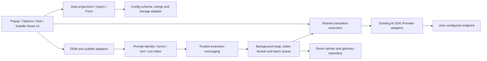

# Read Frog Lite technical stack and boundaries

Applies to 0.2.5, starting at `18f2c8cbfddc3df5e4b7552a48b1731c28ac4cfd`. See [implementation and acceptance status](docs/performance/IMPLEMENTATION.md), [audit inventory](docs/performance/audit-inventory.json), and [measurements](docs/performance/PERFORMANCE.md).

## Execution model

- Node >=24, pnpm 12.10.1, frozen lockfile, WXT 0.21.4 / Vite 8 / TypeScript 7 / React 19. Install the repository's messaging patch through pnpm. Do not upgrade dependencies as a side effect of performance work.
- Chromium MV3 service worker owns page/subtitle request queues, durable caches, background services and privileged browser integration. Popup, Options and Translation Hub are extension pages. Host/subtitle content scripts run in the isolated world; page-world injectors have narrowly scoped editor/player bridges.
- Content scripts remain browser-injected IIFEs. No runtime extension ES-module import through a website-controlled Service Worker. `pnpm check:architecture --build` verifies the generated content scripts.
- Translation Hub also uses the existing shared `executeTranslate` path in its extension page. Do not move it across contexts merely to make a diagram uniform; preserve cancellation, protocol and credential boundaries.
- Services use user-configured endpoints. No new official account, analytics or proxy service is introduced. Credentials and original prompts/text never belong in diagnostic logs, page DOM, page-world bridges or performance artifacts.

## Technology decisions

| Responsibility             | Standard                                                                         | Governance result / retained exception                                                                                                                                                           |
| -------------------------- | -------------------------------------------------------------------------------- | ------------------------------------------------------------------------------------------------------------------------------------------------------------------------------------------------ |
| Shared UI state            | Jotai, with narrowly selected config fields                                      | Deep-equal config slices suppress notifications from cloned storage records. Do not duplicate Form drafts or Query results in atoms.                                                             |
| Async UI results           | TanStack Query                                                                   | Owns request/result lifecycle, including bounded TTS audio cache. Persisted config remains in browser storage.                                                                                   |
| Form drafts and validation | TanStack Form and Zod; existing autosave controller                              | Import `useSelector` from Form. Removed direct `@tanstack/react-store`; the identical Store version remains a Form dependency.                                                                   |
| Accessible primitives      | Base UI with repository wrappers                                                 | shadcn describes generated source and supplies build CSS; it is not a second runtime component system. Moved shadcn to devDependencies, retaining its CSS license.                               |
| Styling                    | Tailwind / existing CSS variables                                                | Preserve Shadow DOM styling, native focus and accessibility. Keep existing animation behavior.                                                                                                   |
| Icons                      | Static named Tabler imports preferred for new fixed icons                        | Retain offline Iconify for persisted names and existing call sites, plus the small Remixicon exception. Iconify correctly classified as runtime. Never enable network icon lookup.               |
| Brand assets               | Existing local provider assets                                                   | Brand marks are not replaced with generic UI glyphs. Preserve applicable notices.                                                                                                                |
| Animation                  | CSS/native for simple effects, Motion where used for springs/complex transitions | No speculative removal. Package count is not a substitute for frame-time measurements.                                                                                                           |
| Dragging                   | dnd-kit for sorting, react-rnd for movable/resizable panels                      | Different interaction and accessibility contracts; retain both.                                                                                                                                  |
| Editors                    | CodeMirror 6 through UIW; existing state/view/lint/language imports              | Keep direct dependencies used by source/peer contracts. Stable extension/setup identities avoid reconfiguration. Advanced JSON editors load on first expansion and retain drafts after collapse. |
| Site editor compatibility  | Existing editor adapters and native DOM/events                                   | Lexical stays a development dependency: tests instantiate a real editor. It is not bundled as the site's editor implementation.                                                                  |
| Translation protocols      | AI SDK 7 and existing provider-specific adapters                                 | Keep `generateText()`, full paragraphs, model/headers/reasoning semantics, and SDK retry disabled where our queue owns retries. Do not rewrite mature adapters.                                  |
| Scheduling                 | Existing priority heap + token bucket + batching                                 | `rate`, `capacity` and optional `maxConcurrent` have separate meanings. No new scheduler framework. Default concurrency remains unbounded pending representative evidence.                       |
| Subtitle lookup            | Typed-array start/prefix-max-end index                                           | Sorted tracks: O(n) construction, O(log n) query, about 16n bytes for index arrays. Unsorted/invalid tracks retain original-order linear lookup.                                                 |
| DOM work                   | Existing chunked traversal + Set/Map indices                                     | Coalesce scan roots by composed ancestry; preserve synchronous invalidation/cleanup. Hover mutations use indexed ancestry, observers have explicit ownership.                                    |

## Storage ownership and invalidation

| Store                         | Owner and lifetime                                                        | Invalidation / release                                                                                                                   |
| ----------------------------- | ------------------------------------------------------------------------- | ---------------------------------------------------------------------------------------------------------------------------------------- |
| `browser.storage` through WXT | Versioned user configuration/preferences                                  | Schema validation and existing migrations; UI projects the stored facts. Serialized writes and watch generations remain intact.          |
| Dexie                         | Durable translation, segmentation, summary caches and glossary repository | Existing tables/export formats retained. Translation identity moves to `translation:v2:`; no old result migration or user-data deletion. |
| In-memory translation cache   | Content-context fast lookup                                               | Existing bounded eviction and context lifetime; keys use the same verified v2 identity.                                                  |
| Active glossary matcher       | Compiled term matching per scope/language/revision                        | In-flight dedup and generation invalidation retained. Never stamp terms with a revision from another matcher generation.                 |
| TanStack Query                | Async UI data / TTS audio                                                 | Existing key, stale and GC rules; cancellation belongs to the active request owner. Unmounted TTS owners cancel and ignore late audio.   |
| Subtitle time index           | Track-version-local derived data                                          | Rebuild on replacement/merge/resegmentation, not each playback tick. Do not persist derived indices.                                     |

## Allowed dependency directions

1. Pure queue, glossary matching, prompt identity/context, subtitle index/transcript and text preparation must not import React, Jotai, Toast or components. Configuration merge/storage is below UI state. Background must not transitively import UI runtime modules.
2. UI and DOM adapters may depend on those cores. Toast validation lives in `utils/host/translate/ui/validate-config.ts`. DOM rendering/spinner/error adapters remain UI-aware intentionally.
3. Content scripts and extension-page code must not import `entrypoints/background` implementations; use the trusted message contract or shared framework-independent services.
4. Type-only imports do not create runtime edges. Boundary checks use the installed Vite/Oxc parser, follow local static and literal dynamic edges, and validate generated content scripts. Computed imports, generated virtual modules and CSS need build review too; the checker is not a security sandbox.
5. Subtitle/audio controllers retain their existing small adapters to UI state. Do not introduce a general event bus, service container or universal cache abstraction for cosmetic consistency.

## Dependency change policy

- Before removal: inventory source, tests, CSS/config, peer dependencies and rendered build graph. Check licenses. A zero production TS import count alone is insufficient.
- Before replacement: record measured benefit, migration and compatibility cost, retained behavior, and rollback. Prefer the installed mature library or browser APIs. Update source, lockfile, notices and relevant regressions together.
- This series changes no resolved package version or transitive snapshot. One direct dependency is removed; two are reclassified. The notice file is regenerated to exclude development-only tooling while retaining shipped CSS, offline icon, font and brand notices.
- The icon prototype covers 77 names and saves 1,704 gzip bytes in an isolated entry with React external. It does not prove whole-app startup, Iconify prop/ref compatibility, accessible markup or brand equivalence. Full migration is not adopted without production evidence. Existing saved Action names remain valid.
- Require deterministic identity, cancellation, resource-ownership and import-boundary checks. Performance reports start as observations; enable per-scenario thresholds only after repeat-run noise analysis. Never gate on an unvalidated global percentage.

## Routine commands

`pnpm check:architecture` checks source boundaries; add `--build` after a production build. `--report` refreshes the file/dependency inventory. `pnpm perf:report` emits raw Node/JSDOM observations. `pnpm perf:icons` compares isolated icon entries. `node scripts/build-fingerprint.mjs` records produced file hashes. See the performance report for production browser and 30-minute soak commands and their limits.
