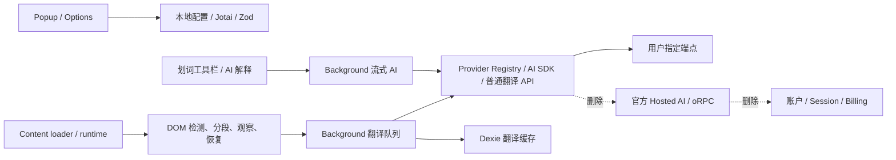

# Read Frog Lite 删除计划与基线

任务日期：2026-10-29。独立本地分支：`codex/read-frog-lite`。禁止 push / 发布。

基线：`aa6d54d1b9fde901fa7dbc00540a196fd28cd388`，v1.54.1。工作区预置 clone 的 origin 为 `https://github.com/poohyeban/read-frog.git`，任务指定上游为 `https://github.com/mengxi-ream/read-frog`。以检查过的本地 SHA 为比较基准，保留 GPLv3 与作者归属。原始指标见 `baseline.json`。

## 架构与删除边界

| 分类   | 模块                                                      | 理由 / 边界                                     |
| ------ | --------------------------------------------------------- | ----------------------------------------------- |
| KEEP   | `utils/host`、`content-runtime/host`、iframe 注入         | 复用 DOM 翻译、动态网页和恢复逻辑               |
| KEEP   | Popup、Options 的语言/API/模式/快捷操作                   | 核心配置与触发入口                              |
| KEEP   | 用户 Provider、请求队列、重试、取消、缓存                 | 核心翻译与性能、可靠性                          |
| KEEP   | OpenAI、OpenAI-compatible、Gemini、Ollama                 | 用户直连自己的服务                              |
| KEEP   | 划词翻译、现有基本解释的请求及渲染                        | 删除附加 Actions 时保留解释                     |
| REMOVE | Auth、Billing、Hosted AI、oRPC、账户 UI                   | 不依赖官方账户或授权状态                        |
| REMOVE | Notebase、复习、云笔记、Google Drive 同步                 | 私人翻译扩展不需要                              |
| REMOVE | 字幕、转录、TTS、安装引导、卸载调查、推广、遥测           | 非核心代码及后台调用链一起删除                  |
| REVIEW | 自定义 Actions、layout-engine、definitions                | 保留解释实际需要的最小边界，不能按包名删除      |
| REVIEW | 非 AI 翻译服务、其他 Provider、术语表、输入翻译、翻译 Hub | 评估双语/译文模式支持与维护成本，删除非必要功能 |
| REVIEW | 权限、资源、本地迁移、通用 UI                             | 按最终引用与实际用途裁剪                        |

## 阶段

0. 记录基线、安装/构建/测试结果与依赖图，独立提交。
1. 删除账户、商业化、官方托管调用与云笔记依赖；保留用户服务路径，构建和必要测试后提交。
2. 删除剩余非核心业务、专属状态/存储/消息/测试，保留基本划词解释后提交。
3. 审计 npm 依赖、资源、权限、环境与构建配置，更新锁文件后提交。
4. 复审不可达代码、多余状态与通信；运行类型/Lint/测试/生产构建，提供体积、网络审计与浏览器手动验收步骤后提交。

每阶段以可运行的核心路径为边界；不伪造授权、不保留空实现。不使用真实 API Key 进行基线或构建。

## Phase 0 实测结果

- 指定上游 `git ls-remote ... HEAD` 与本地 SHA 相同，预置 fork 不影响本次基线。
- 使用预置 pnpm 12.10.1 / Node 26.12.1，`pnpm install --frozen-lockfile` 成功。最初 PATH 中 pnpm 11 与受限 HOME 导致失败；离线缓存不全，启用允许的网络后重装成功。
- Chromium 原版生产构建成功，11.8 秒。使用 `WXT_SKIP_ENV_VALIDATION=true`，因为原版要求 Google OAuth / PostHog 构建变量，本任务不提供这些凭证。
- `oxlint --type-aware --type-check` 成功（原版 lint/type-check 脚本相同）。
- `SKIP_FREE_API=true WXT_SKIP_ENV_VALIDATION=true vitest run`：411 文件通过、1 文件跳过；4370 测试通过、4 跳过；123.91 秒。跳过的免费翻译真实外网测试遵循 AGENTS.md。
- Vitest 初次因沙箱禁止 localhost 端口启动失败，允许测试所需网络后通过，不是代码缺陷。
- 原版已有 PostHog sourcemap 警告和 jsdom navigation 未实现提示。

## Phase 1

移除账户 UI、Better Auth 客户端、官方 oRPC、Hosted AI Registry/流式分支、额度/套餐选择与 Cookie 监听。因依赖同一账户链，云笔记、复习入口、字幕与转录、引导、Hub、Drive 同步一起删除；自定义 Actions 编辑器也删除，已有划词解释执行/渲染保留。Lite 使用独立配置键 `readFrogLiteConfig` 和 schema v1，不导入上游配置，删除 115 版迁移链。恢复界面的本地配置导出保留。

必要回归：DOM/翻译核心/请求队列与新装 Provider 配置测试 24 文件、360 测试通过。生产构建 13.43 MB（阶段中间结果），类型/Lint 检查后提交。专属 Hosted/Notebase/字幕测试删除，混合测试仅移除已删除功能的用例；最终阶段继续运行全量剩余测试。

## Phase 2

移除朗读/Edge TTS/offscreen、输入框翻译、浮动工具/侧边内容、词库、推广/评价/博客、遥测事件发送及上下文字段。删除专属消息、配置、清理任务、数据库表和测试。保留翻译/摘要缓存及请求队列；批处理统计将在终审继续评估。

发现 `@read-frog/layout-engine` 的单独许可证限制独立修改产品使用，移除其全部运行时依赖，复用原 GPL 代码的字段列表渲染 AI 解释。下一阶段从 package/锁文件删除该包。`@read-frog/definitions` 仍提供核心语言表和校验，需保留并继续审计实际用途。

类型/Lint 通过；Chromium 构建成功（WXT 11.65 MB，5.446 秒）。首次全量：190 文件/2141 测试通过，14 文件失败（删除功能的旧断言、旧配置键/迁移预期、渲染测试替身）；更新后失败范围复跑 12 文件通过、2 文件失败，最后 2 文件/15 测试也通过。保留流式取消、重试、Provider 切换测试。最终仍将重新运行全量以核实阶段间组合结果。

## Phase 3

Provider 收敛到 OpenAI / OpenAI-compatible / Gemini / Ollama，以及待终审的 Google Translate。删除无消费者模块、失效 SDK、专属资源、旧迁移样本、环境变量/官方 monorepo 别名、自动发布配置和 Nx。图标使用现有 Tabler MIT 数据与 Iconify offline 渲染，移除图标 CDN/代理和官方电子书桥接。精简语言资源，保留运行时实际使用的键及动态键前缀。

Manifest 删除 cookies、identity、offscreen、sidePanel、unlimitedStorage；保留 storage、tabs、alarms、contextMenus、scripting、webNavigation 和任意网页/自定义 API 主机访问。移除上游固定开发扩展 ID。扩展与 npm 名称改为 Read Frog Lite，版本 0.1.0。

锁文件更新并安装成功。移除自动下载 Node 的 runtime 声明，要求本机 Node >=24；这是为避免依赖删减时包管理器改选新 Node 并访问未配置镜像，原基线的 Node 26.12.1 与最终 Node 24.19.0 差异会影响耗时比较。类型/Lint 通过，生产构建 9.01 MB，3.807 秒，不再需要任何环境变量。全量 186 文件/1924 测试通过，2 个真实免费翻译测试按 AGENTS.md 跳过；仅 4 个已删除电子书桥接用例失败，其专属测试文件随后删除。

## Phase 4

最终删除非公开 Google Translate 传输、额外 LLM 语言检测、写作改写、Actions 自定义数组/排序/固定状态、批处理统计、远程图标代理、Session 请求缓存、失效搜索入口、旧截图、剩余云同步类型和无消费者函数。只保留四种用户 API、本地语言检测、词典/句子分析。清除预置自动翻译站点；可选上下文摘要默认关闭。

安全收口：API SDK 与模型查询显式省略 Cookie 并拒绝重定向；凭证不进入请求正文或 URL；开发日志不输出原始 SDK 错误对象；无密钥导出同时去除自定义请求头，清理失败时不导出原对象。新增真实 SDK 请求拦截、本地配置重载、旧 Hosted ID 拒绝、导出凭证清理测试，保留流式取消/重试/固定弹窗/快捷键及 DOM 回归。

最终数据与检查见 REPORT.md 和 final-metrics.json。Chromium 154 实测启动成功，但管理员策略拒绝加载未打包扩展，未将浏览器交互验收冒称通过。过程中自动审批曾拒绝范围过宽的组合编辑；改为逐文件修改、确认引用后再清理，并重新验证，未绕过审批或留下待批准操作。
