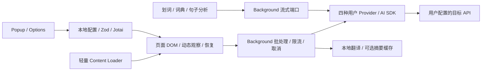

# Read Frog Lite 删减报告

2026-10-29。本地分支 `codex/read-frog-lite`，基于 Read Frog v1.54.1，原始 SHA `aa6d54d1b9fde901fa7dbc00540a196fd28cd388`。原始仓库为 [mengxi-ream/read-frog](https://github.com/mengxi-ream/read-frog)；工作区预置 fork 的 HEAD 与指定上游一致。未修改远端、未 push、未发布。

最终产品为 Chromium Manifest V3 扩展 **Read Frog Lite 0.1.0**。核心实现沿用上游；只支持用户自己的 OpenAI、OpenAI-compatible、Gemini 和 Ollama。不需要 Read Frog 账户，也没有内置免费翻译服务。

## 1. 实际删除内容

| 模块             | 删除范围                                                                                                                                     |
| ---------------- | -------------------------------------------------------------------------------------------------------------------------------------------- |
| 账户及商业化     | 登录/登出、Google OAuth、Better Auth、Session 查询、账户菜单/资料、Billing、Pro/Ultra、配额/升级提示、Hosted AI Registry 和账户授权分支      |
| 官方云服务       | oRPC/API contract 客户端、官方 AI 中转、权益探测、云笔记、Notebase、Drive 同步、账户相关存储和 Cookie 监听；没有伪造授权或绕过服务端验证     |
| 学习及非核心业务 | 复习/闪卡/FSRS 相关业务、学习账户、视频字幕与转录、TTS/offscreen、输入框翻译、术语表、翻译 Hub、浮动工具及侧边内容                           |
| 自定义 Actions   | 新建/编辑 Actions、Liquid/富布局、写作改写、排序/固定状态、示例数据、Notebase 连接；仅复用执行器保留词典和句子分析，结果使用上游已有字段列表 |
| 推广及遥测       | PostHog、埋点、博客/新功能/评价/赞助入口、安装引导、卸载调查、官方电子书选择桥接及相关事件                                                   |
| 多余基础设施     | 云端迁移链、旧迁移样本、Session 请求缓存、通用后台 fetch、远程图标代理、批处理用量统计及表/清理任务、未使用类型/函数、失效消息和设置搜索入口 |
| 资源与工具       | 旧功能图片/演示截图、在线 Provider 图标、图标 CDN、失效语言资源、无用环境变量、Nx、上游 monorepo 别名、Changesets/自动发布流程               |

非 AI 翻译候选最终全部删除。Google Translate 适配依赖非公开网页客户端接口和固定客户端密钥，维护与协议风险不值得为私人版本保留；其源文件、请求链和专属测试一并移除。额外调用模型的语言检测也删除，保留 `franc` 与页面元数据检测。

配置键改为 `readFrogLiteConfig`，IndexedDB 改为 `ReadFrogLiteDB`，schema 从 Lite v1 开始。不读取或迁移官方扩展的账户/配置。默认自动翻译站点和语言列表为空；上下文摘要默认关闭。

## 2. 依赖与许可证

直接运行依赖从 **93 → 54**，开发依赖从 **41 → 34**；没有新增大型依赖。完整逐包名单保存在 [final-metrics.json](final-metrics.json)。锁文件已更新，冻结锁文件安装通过。

主要删除：

- `better-auth`、`posthog-js`、`@orpc/client`、`@orpc/contract`、`@orpc/tanstack-query`。
- `@read-frog/api-contract`、`@read-frog/layout-engine`。
- 不再支持的 19 个 `@ai-sdk/*` 包，包括 Anthropic、Azure、Bedrock、DeepSeek、Groq、Mistral、Open Responses 等；这些服务如支持标准 Chat Completions，可由用户自行配置兼容端点。
- `liquidjs`、`dompurify`、`react-markdown`、`@codemirror/lang-liquid`、Headless Tree、`morphdom`、`entities`、`@webext-core/isolated-element`。
- `nx`、Changesets、Faker、React Query Devtools、`eruda`、`lexical` 等独占开发工具。

主要保留及用途：

| 依赖                                             | 实际用途                                                |
| ------------------------------------------------ | ------------------------------------------------------- |
| `ai`、三个 `@ai-sdk/*`、`ai-sdk-ollama`          | 四种用户 API、流式/结构化解释                           |
| React、Base UI、Jotai、React Query、React Router | 复用现有 Popup/Options/划词界面及状态                   |
| WXT、WebExt messaging/match-patterns、Zod        | MV3 构建、扩展通信、站点匹配、配置校验                  |
| `franc`、`defuddle`                              | 本地语言识别、网页正文提取                              |
| Dexie、SHA256、请求队列实现                      | 本地翻译/摘要缓存、去重、重试、限流和取消               |
| CodeMirror、CSS parser、DnD Kit                  | 原有 JSON/提示词/样式与站点规则编辑，不新增编辑能力     |
| i18next、字体、离线图标                          | 本地界面资源，无图标 CDN 请求                           |
| `@read-frog/definitions`                         | 语言编码、语言名称、方向/配置类型校验；没有官方服务调用 |

GPLv3 `LICENSE`、上游历史与作者归属保留，README 标明修改版本及原作者。发现 `@read-frog/layout-engine` 的独立许可证有限制后，没有复制其实现，删除依赖并复用 GPL 仓库已有渲染器。Tabler 离线图标保留 MIT 文本。

**来源限制：** `@read-frog/definitions@0.11.0` 的已安装包没有明确的 `license` 字段或包内许可证，仓库指向上游 monorepo。本次未把其许可推断为 GPL，也未重新发布该包；它是语言能力的真实依赖。若以后对外分发，仍需核实该包独立的许可依据。

## 3. 实测体积

口径：`src/` 下全部普通文件（包括测试/资源）；依赖为 package.json 直接声明数量；生产体积为 `.output/chrome-mv3/` 下全部文件的未压缩字节总和。原始数据见 [baseline.json](baseline.json)，最终数据见 [final-metrics.json](final-metrics.json)。不是 npm 安装目录体积。

| 指标                |       原版 |      Lite |   减少 |
| ------------------- | ---------: | --------: | -----: |
| 源码文件数量        |      1,592 |       621 | 60.99% |
| 源码总字节          | 12,898,408 | 3,733,210 | 71.06% |
| 直接运行依赖        |         93 |        54 | 41.94% |
| 直接开发依赖        |         41 |        34 | 17.07% |
| Chromium 生产总字节 | 20,452,994 | 8,020,047 | 60.79% |

压缩后的加载包见 `.output/read-frog-lite-0.1.0-chrome.zip`，压缩大小及 SHA256 记录在指标文件。

| JavaScript 产物                   |  原版字节 | Lite 字节 |
| --------------------------------- | --------: | --------: |
| `content-runtime.js`              | 3,353,488 | 2,095,432 |
| `background.js`                   |   456,923 |   149,865 |
| 字幕 content script               | 4,126,284 |      删除 |
| 引导 content script               | 1,296,885 |      删除 |
| `content-runtime/index.full-*.js` |   711,517 |   711,517 |

其他 chunk 在删减后重新划分，不能把名字变化当作等价体积对比。最终较大的共享 chunk 是 `provider-ref-*.js`（1,209,118 字节）和 `_virtual_wxt-plugins-*.js`（695,396 字节）。它们与内容脚本仍共享 SDK、UI 和语言数据；没有为了压缩数字改写核心引擎。

构建耗时实测：原版 11.8 秒，最终 3.557 秒。原版 Node 26.12.1，最终 Node 24.19.0，缓存状态也不同，因此仅作本次观测，不能据此宣称运行时提速。没有完成真实浏览器 CPU/内存性能基准。

## 4. 最终架构与停止边界

Background 在 MV3 启动时同步注册消息，保留服务工作线程唤醒可靠性。Content loader 按需加载主要运行时，保留 iframe、Shadow DOM、富文本/公式占位符、动态变化、双语布局、仅译文原位替换和恢复机制。

删除了只有设置没有消费者的 Provider 会话快照、统计状态、云端元数据与重复网络缓存。内存翻译缓存与 IndexedDB 分别处理当前页面去重和跨刷新复用，职责不同。两个本地清理 alarm 仅清理翻译/摘要缓存，没有远程轮询。

最终仍保留原有提示词、样式/站点规则、JSON Provider 高级参数编辑：它们用于不同模型和复杂网页的兼容修复，删掉会收窄已有维护手段；这些能力没有扩展。保留 React/WXT/消息与合理模块边界，避免把删减变为重写。停止在不再有明确可整块移除、且不损害所保留翻译路径及兼容维护能力的边界。内部部分 `customAction` 等历史命名沿用，不代表仍存在动作编辑器或学习服务。

## 5. 网络与凭证审计

| 目标                                                        | 触发条件                                   | 发送内容                                                               |
| ----------------------------------------------------------- | ------------------------------------------ | ---------------------------------------------------------------------- |
| OpenAI 默认 `api.openai.com`，或用户指定 Base URL           | 网页/划词翻译、解释、连接测试              | 文本、按提示词使用的页面/段落上下文、语言/模型参数、该 Provider 的凭证 |
| Gemini 默认 `generativelanguage.googleapis.com`，或指定端点 | 同上                                       | 同上，API Key 通过 SDK 请求头                                          |
| OpenAI-compatible 指定端点                                  | 同上；用户点击获取模型列表时查询 `/models` | 翻译/解释内容；模型查询只带该服务鉴权信息                              |
| Ollama 默认 `127.0.0.1:11434`，或指定端点                   | 同上                                       | 模型请求；只有用户设置时才携带 API Key                                 |
| 当前选定 Provider                                           | 用户启用上下文摘要并触发翻译时             | 有长度限制的页面标题和正文，用于生成本地缓存的翻译上下文               |
| Provider/AI SDK 文档页面                                    | 用户明确点击相关文档链接                   | 普通浏览器导航，不拼接 API Key                                         |

没有 Read Frog Session/Billing/Hosted AI、遥测、推广、远程配置、云同步或图标 CDN 请求。默认没有自动翻译规则；用户自行启用规则后，匹配网页可自动请求所选 API。安装及空闲初始化只读取本地配置/资源。

密钥保存在扩展本地 storage，未加密到独立密钥库；它不进入网页 DOM、构建变量或上传型日志。模型工厂与模型列表请求均设 `credentials: omit`、`redirect: error`，避免 Cookie 附带及重定向转发凭证。真实 SDK 请求拦截测试验证四个 Provider 的目的地址、鉴权头、正文及 URL。测试仅使用虚拟密钥，没有请求真实服务。

生产 logger 为关闭状态；删去了 SDK 原始错误对象及摘要文本日志。构建拒绝 `WXT_*API_KEY`：负向测试证实构建失败且日志不包含测试密钥值。最终产物扫描未发现测试密钥标记、官方 API 域名和三个 Iconify CDN 域名。恢复界面的“无密钥导出”会删除 `apiKey` 和自定义 headers，清理失败时拒绝导出；显式“包含密钥导出”仍会产生用户主动要求的本地明文文件。

权限保留 `storage`、`tabs`、`alarms`、`contextMenus`、`scripting`、`webNavigation`。删除 `cookies`、`identity`、`offscreen`、`sidePanel`、`unlimitedStorage`。`*://*/*` 保留用于任意网页翻译、iframe 注入与自定义 API，不能在不限制这些能力的情况下缩为固定域名。

## 6. 检查结果与限制

- 原版基线：类型/Lint、Chromium 构建通过；411 个测试文件、4370 个测试通过，4 个真实免费 API 测试按 AGENTS.md 跳过。最初受限端口/包管理器失败属于环境问题，未归为回归。
- 最终：类型/Lint 通过，格式检查通过；**173 个测试文件、1830 个测试通过，无跳过**。最后两处离线图标导入另做提示词组件回归及生产构建/产物扫描。
- 冻结锁文件安装、MV3 生产构建、Manifest/产物凭证检查、API Key 构建拒绝测试通过。
- 单元/组件回归覆盖：双语和仅译文 DOM 处理、原文恢复、动态 DOM、HTML/公式占位符、缓存、重试、取消、划词流式更新/重跑/固定弹窗/快捷键、Provider 配置、本地重载及旧 Hosted ID 拒绝。
- jsdom 仍有原版已存在的 navigation 未实现提示，不等价于扩展控制台异常。
- **真实扩展交互尚未验证：** 本环境 Chromium 154 能启动，但管理员策略拒绝加载未打包扩展（`Loading of unpacked extensions is disabled by the administrator.`）。未修改策略或绕过限制。不能宣称已验证真实网页控制台、交互、性能或 Edge 行为。
- **真实在线服务尚未验证：** 未使用真实 API Key 测试四家服务；模型列表继承上游，实际可用模型由用户账户/本地安装决定。使用最终 API 地址，HTTP 重定向会被拒绝。
- 本地语言检测对很短或混合语言文本可能返回未知；此时保留原有回退行为。词典/句子分析使用基本字段列表，取消了复杂可编辑布局，部分结构化字段会作为文本呈现。
- 部分简化说明在非中文/英文界面中保留英文；没有承诺完成全部翻译文案的人工校对。
- 没有已确认的最终自动化失败。真实网站兼容、服务端结构化输出差异、扩展实际加载行为和上述依赖许可来源仍需后续核实；本次没有为这些不确定项添加新功能。

## 7. 手动验收步骤

使用干净 Chrome/Edge 用户配置，打开扩展页的开发者模式，加载解压后的 `chrome-mv3` 目录。以下每项都需在真实浏览器执行，不能用本报告的单元测试代替。

1. **无账户启动：** 打开 Popup/Options，不出现登录/套餐/额度入口；先不填 Key，触发翻译应给出配置提示。
2. **四种 Provider：** 分别填入可用的 Key、最终 Base URL、模型，为网页翻译、划词翻译和两种解释选择对应 Provider；使用“测试连接”。Ollama 须已启动，并允许当前扩展来源。
3. **双语：** 在普通英语文章开启全文翻译，确认原文和译文同时可读；滚动、动态追加段落、展开折叠内容，检查继续翻译且不重复插入。
4. **仅译文：** 切换为仅译文，检查正文、链接、行内强调、公式及页面标题；原文不应与译文混排。
5. **关闭与取消：** 翻译完成后关闭，比较正文、标题、链接；请求尚在进行时关闭，等待请求结束，不应再次插入译文。
6. **划词：** 选择单词/跨节点句子，点击翻译；切换目标语言、重新生成、固定后更换选区、关闭弹窗；确认没有陈旧结果覆盖新结果。测试词典与句子分析、配置的快捷键。
7. **配置持久化：** 修改语言、模式、Provider 后刷新页面，关闭重开浏览器；设置仍在，无需账户。确认官方扩展原数据未被读写。
8. **复杂页面：** 在动态 SPA、iframe、Shadow DOM、长文章上检查重复/遗漏翻译和恢复；单独记录失败网址及最小复现。
9. **网络/凭证：** 同时打开页面与扩展 Service Worker DevTools 的 Network；空闲时没有官方账户/Billing/Hosted/CDN 请求，主动翻译只到所选端点。确认 Key 仅在该端点鉴权头，不在 URL、正文、日志或页面 DOM。用返回 302 的自有测试端点确认请求停止。
10. **错误及缓存：** 断网、填写错误 Key、测试 429；错误应可理解且可重试。重复翻译确认缓存复用，清理缓存后应重发请求。检查页面/Service Worker 控制台没有因删减产生的未处理异常。

## 8. 阶段提交与产物

| 阶段    | 本地提交                                                                        |
| ------- | ------------------------------------------------------------------------------- |
| Phase 0 | `cfe00578` — 基线与删除计划                                                     |
| Phase 1 | `8cb25cc5` — 账户及 Hosted 云服务删除                                           |
| Phase 2 | `5a161e56` — 非核心业务与遥测删除                                               |
| Phase 3 | `37511658` — Provider、依赖、资源、权限清理                                     |
| Phase 4 | 本报告所在提交：`refactor(lite): finish subtraction and audit core translation` |

可加载目录：`.output/chrome-mv3/`。本地 ZIP：`.output/read-frog-lite-0.1.0-chrome.zip`。这些是本地构建产物，不是商店发布版本。README 提供安装与构建方法，PLAN.md 保留分阶段观察，不覆盖基线失败记录。
