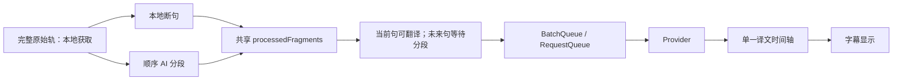
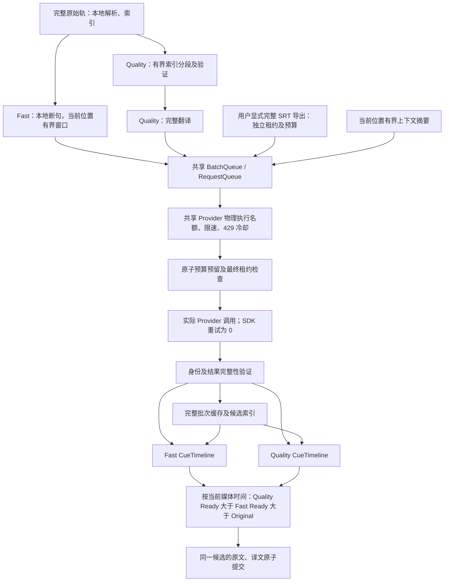

# Read Frog Lite 双通道字幕引擎 v2：实施与本地验收

本轮已完成双通道实现及新增 P0 约束。仅本地开发、提交、Mock 测试与 WXT 构建；没有推送、PR、Release、Actions 或真实付费模型调用。原始基线为 `c2cafda89cc936a38ff0ff48d43a4f3ac497856b`（v0.2.6），开始时工作区干净。实现提交为 `f5d54bf7`，预算提高后的显式恢复修复为 `f5a1460a`。

浏览器验收使用 Chromium 154.0.8037.57、Node 24.19.0、实际引擎类及本地 Mock Provider。环境的扩展安装策略禁止加载扩展，**以下结果不是原生 MV3、真实网站登录态或真实模型质量认证**。文末列出未完成的现场验证与 Chrome 复现步骤。

## 1. 新旧执行链与状态所有权

旧链中，未来字幕的翻译准入依赖 AI 分段完成。当前句可以提前翻译，但后续句仍可能逐句等待；分段还改变翻译输入数组。



新链复用 CueTimeline、Provider Adapter、Dexie、批次缓存与原有队列，在执行边界补充租约、累计预算和物理并发控制。没有保留第二套播放调度器，也已删除不再使用的 `isAwaitingSegmentation` 准入逻辑。



| 状态                                      | 唯一所有者与更新规则                                                             |
| ----------------------------------------- | -------------------------------------------------------------------------------- |
| 原始字幕、本地基线、视频/轨道/配置身份    | UniversalAdapter；完整轨可以保存在本地，AI 不覆盖 Fast 的输入数组                |
| Fast / Quality 生产、待执行批次、失败冷却 | TranslationCoordinator；两套 ready Map 与稳定数组投影，最多各 2 个待完成翻译批次 |
| AI 分段结果与分块完成状态                 | SegmentationPipeline；按来源块身份保存，密集重叠时间不能互相抹除                 |
| 展示时间轴                                | SubtitlesScheduler；各自 CueTimeline，原子发布完整候选；相同候选不重复更新 React |
| 播放资源与任务代次                        | SubtitleSession；立即关闭本地准入，撤销后台根租约后才完成 stop                   |
| 实际调用资格、累计消耗                    | Background SubtitleWorkRuntime；租约只存在于当前 Worker，消耗持久化在 IndexedDB  |
| 全量导出                                  | 独立 SubtitleSession；独立估算、预算、进度、取消与文件组装                       |

每次 timeupdate、Seek、seeked、playing、缓存恢复和新结果到达，都重新按当前时间选择。Quality 必须同时具备验证有效的分段与完整译文；允许不同边界直接接管，原文与译文始终来自同一候选。没有“第一次显示 Fast 后永久锁定”的状态。有效的历史 Quality 保留；取消任务的迟到结果不进入当前 UI。

## 2. 连续缓冲、预读与背压

`continuousReadyMs` 使用有效译文区间的并集检查下一段真实语音，遇到第一个未翻译的语音缺口即停止。静音不消耗翻译任务；未来零散已完成的句子不能虚增连续水位。嵌套、重叠字幕使用已覆盖位置避免重复计算。

以最近 32 个翻译任务的端到端耗时（包含队列等待）估计 P95：

- 低水位 `L = clamp(2 × P95 + 2 秒, 8 秒, 30 秒)`。
- 高水位 `H = clamp(L + 12 秒, 20 秒, 60 秒)`。
- Quality 连续覆盖除以播放倍率后达到 H，停止 Fast 新增投机请求；低于 L 则恢复。单句 Quality 成功不会关闭整个 Fast。
- Fast 查询窗口为 `max(30 秒, H) × rate`，媒体时长最多 240 秒；每次仅选最多 128 个候选，再分成有界小批次。当前位置以前的字幕不会默认重译。
- Quality 查找窗口为 60 秒乘倍率，最多 240 秒；边缘完整块最多再覆盖 60 秒。**单次 AI 请求仍不得超过 60 秒**。密度高时先处理最近的块，不扩大批次限制。
- 倍率最多按 4× 扩大预算窗口。暂停保持窗口有界；隐藏页面停止新投机工作；广告期间暂停并取消不适用工作。
- Provider 并发设为 1 时，先建立至少 `Quality 延迟 P95 + L` 的 Fast 连续余量，再允许 Quality 分段。Quality 延迟初始估计 15 秒，之后由实测更新。

无法抢占已经发送且不响应 AbortSignal 的远端请求。已占用唯一名额时，急需字幕只能等待该请求实际结束；下一可用名额优先交给紧急字幕。实现没有把本地 Promise 取消误认为远端执行结束。

## 3. 六类限制分别生效

| 控制            | 当前值、作用域及含义                                                                                                                                  |
| --------------- | ----------------------------------------------------------------------------------------------------------------------------------------------------- |
| 请求速率        | 保留用户现有 RequestQueue rate/capacity；默认 8 请求/秒、容量 20，未自动提高。字幕两通道、AI 分段、隐式摘要、导出共用字幕队列；网页保留自己的速率设置 |
| 实际并发        | 全局 8；同 Provider 账户默认 2，可设 1–4。账户身份包含 Provider、URL、凭据的散列，不按模型拆开名额。网页与字幕共用物理名额和 429 冷却                 |
| 投机软预算      | 自动播放累计请求数、估算 Token 的 80%；耗尽后停止 Quality 与远期 Fast 新请求                                                                          |
| 紧急预留        | 默认累计额度的 20%；仅当前/低水位 Fast 可继续使用，仍受硬预算限制                                                                                     |
| 累计调用硬上限  | 自动播放默认 3,000 次预留；安装范围内全部标签、视频、模型共用，用户可主动提高总上限                                                                   |
| 累计 Token 保护 | 默认 12,000,000 保守单位；每次预留完整渲染输入的 UTF-8 字节数 + 64，以及输出上限。检查累计估算和已知真实 usage 的较大值                               |

默认请求额度依据：三小时、两秒一句约 5,400 句，保守按每批 4 句估算，每通道 1,350 次，加约 180 次 AI 分段约为 2,880 次；实际 Quality 覆盖会抑制 Fast，批次合并也可减少调用。12M 是这一级工作量下的保守输入与输出额度，不保证任意语言、密度和自定义 Prompt 都能播完三小时。达到额度后用户可在字幕队列设置中提高总额，再关闭/开启字幕继续；显式恢复只清除本地暂停标记，不修改后台消耗。程序没有自动续额或自动重置路径。

**这不是严格金额预算。** 自定义 Provider 的 tokenizer、价格、隐藏推理 usage、输出限制遵守情况可能未知。只有请求次数和本地预留能严格保证；实际供应商费用需要可靠 usage 与单价，不能由本方案虚假承诺。usage 缺失显示“—”，不会显示成真实零消耗。请求已经发出后供应商忽略取消仍可能计费。

### 持久化与原子性

播放 ledger 固定键 `playback`，导出使用显式任务的 `export:<租约>`。Dexie v4 增加预算、尝试表，v5 增加候选表；原有历史表和缓存不清空。刷新、Seek、开关、Session 重建与 Worker 重启都不清除播放 ledger。普通缓存清理也不删除预算；只有用户主动清除扩展存储/卸载会失去它。导出重新启动属于新的显式授权任务；长视频每次都重新估算并确认。

Provider 调用前，在同一个读写事务内检查并扣除请求、Token 和每成员尝试额度；并发争夺最后一份额度只有一个成功。预留后取消或 Worker 中断不退款，宁可少用一次额度也不允许重复消费。SDK 调用紧邻的同步 `onDispatch` 再次检查活跃租约和预留，防止“预算查询期间停止、随后仍调用模型”。真实 Provider 开始次数单独记录，可能小于预留次数。

### 输入和积压的独立上限

| 项目                           | 硬限制                                                          |
| ------------------------------ | --------------------------------------------------------------- |
| 单次字幕条数                   | 32                                                              |
| 单次字幕正文                   | 2,400 字符                                                      |
| 完整渲染 Prompt                | 12,000 字符；包括上下文、用户模板等                             |
| 单次媒体跨度                   | 60,000ms                                                        |
| 输出 Token                     | 128–4,096，按实际输入规模动态计算；AI 分段不再无条件分配 16,384 |
| 每条语义请求的真实尝试         | 3，持久化；首次、重试、拆批、429 恢复均计入                     |
| RequestQueue 等待项            | 每队列 64；生产中的网页、字幕两队列合计最多 128                 |
| Subtitle BatchQueue 未完成成员 | 128                                                             |
| 播放翻译批次                   | Fast 2、Quality 2；分段单个在途块                               |
| 后台活动租约 / 注册工作        | 256 / 512                                                       |

超长单条字幕在本地按至多 1,200 字符及 60 秒拆分，时间按源区间推导。异常密度、4× 或反复 Seek 不扩大上述上限。自动上下文摘要仅使用当前块，正文最多 2,400 字符；完整原始轨获取和本地索引不等于完整轨模型输入。

## 4. 统一重试与调度公平性

字幕实际 SDK 调用设置 `maxRetries: 0`，网络重试交由 RequestQueue。BatchQueue 仍允许有限格式恢复、拆批回退，但每次真实尝试必须通过同一成员 ledger；外层播放冷却不能重新获得额度。

N 个成员最坏情况：首次共享调用用掉每成员 1 次，剩余各 2 次，最多 `1 + 2N` 次实际 API 尝试。4 成员上界是 9；“首次批次 + 格式重试 + 4 个单条回退”实际为 6，之后全部被尝试上限拒绝。相同语义失败次数跨刷新保存，重新打开开关不能绕过；改变真实 Provider/Prompt 等语义身份才是新任务。

播放失败至少冷却 30 秒或 Provider Retry-After，外层最多 2 次任务尝试；永久鉴权失败直接结束。429 使同账户的共享名额进入冷却，恢复时只有一个 token 探测，避免投机洪峰。字幕优先级为紧急 0、Fast 1、Quality 2、后台/导出 3，等待 30 秒后逐步提升优先级；跨队列释放名额时轮换唤醒顺序。

测试验证单并发下慢 Quality 不能被物理抢占、取消后本地及时结束且名额保留、紧急 Fast 下一次执行、导出随后执行；也验证网页大量排队时字幕获得机会及共享 429 暂停。默认并发 2 是保守可配置起点，不是对所有 Provider 最优吞吐量的声明。

## 5. 停止、取消和缓存身份

停止流程：本地关闭准入并使任务代次失效 → 取消批次、AI、摘要、重试计时器及调度监听 → 后台撤销根租约 → 清理该租约队列订阅 → 返回确认 → UI 报告停止完成。撤销失败明确显示失败，不报告成功。异步配置、缓存、flush、重试和最终 Provider 派发都不能恢复失效资格。

最后一个真实订阅者退出时才 Abort；播放停止不取消独立导出订阅。远端不响应 Abort 的任务保留物理名额和去重占位，旧结果不能发布，也不能在其未结束时重新派发同一请求。Worker 重启使旧租约失效，但保留预算账本。Worker 进程重启后不能探知供应商处旧请求是否仍执行；客户端并发约束不等于跨崩溃的供应商并发保证。

共享身份保留完整、有序批次及完整渲染 Prompt 的缓存键。Provider、Prompt、字幕语言、上下文、术语表修订、批次成员等改变会改变对应身份；相同语义和时间区间跨通道、跨标签可以去重。旧单条 LLM 缓存不会冒充新批次结果。候选缓存额外记录批次键/索引、轨道语义身份和术语表版本，恢复时验证原完整批次仍有效。

候选查询最多 300 秒/256 个 bundle；写入时清理超过 7 天的候选，完整有效缓存可复用。预算账本不随此清理。运行时历史 ready/失败记录以当前轨道的有限片段为界；预读工作、上下文访问窗口和诊断另有严格上限。没有通过清空历史缓存来解决身份问题。

## 6. AI 分段与完整 SRT

AI 使用索引协议 `segments: [{from, to, text}]`，from/to 是包含端点的来源字幕索引。验证索引连续且完整覆盖、顺序、无重复、文本内容保留、不跨越大于 1 秒的静音；展示时间从可信原始片段推导。兼容旧 VTT 结果时继续严格使用 `isSegmentationAligned`。失败的 Quality 块不进入可显示时间轴，Fast 独立继续。未启用未经质量验证的融合分段/翻译模式。

完整 SRT 只通过用户导出按钮启动，沿用“AI 智能断句”开关：开启采用验证过的 AI 分段，AI 失败可明确记录降级并用本地断句；关闭采用本地断句。流程为本地获取原始轨 → 估算输入字符、批次数、Token 和有限硬上限 → 长视频确认 → 有界分块处理与校验 → 本地组装完整 SRT。

超过 10 分钟、预计 20 次调用或 100,000 估算 Token 的任一条件即要求确认。导出调用硬额度为预计次数 × 3；Token 硬额度由请求数乘最大允许完整 Prompt 字节及输出上限计算，是可审计的最坏情况保护，不是预计实际消耗。完整三小时原始轨不会进入单个模型请求。

块按 32 条/2,400 字符/60 秒分割，翻译子批最多 5 条，最多 2 个同时等待。单批失败不重跑全片；翻译身份、数量、非空结果或最终覆盖验证失败则不生成“完整 SRT”。当前实现选择明确失败，无伪装完整的部分文件。取消先阻止派发，等独立租约撤销确认后结束进度状态，已经有效完成的缓存保留。

## 7. 诊断与计费口径

默认关闭事件诊断，不持续打印字幕。设置页可开启并导出 JSON。前台播放/Seek、任务创建、分段开始/完成、缓冲变化、Fast 暂停/恢复、候选选择和 stop 确认，与后台 Provider 开始/完成、队列等待、耗时、批次数、缓存、去重、重试/429 退避、Token usage 和拒绝计数使用会话散列关联。

可由 `task-created → provider-start → ready → selected` 区分排队延迟、模型慢和显示延迟；记录的只是媒体时间、枚举、数字和不透明散列，不包含字幕正文、Prompt、Key、URL 或认证信息。事件环最多 2,000 条，会话计数最多 256 组；关闭会清空事件，Worker 重启清空诊断计数，累计预算持久化不变。长时间运行应及时导出，环被覆盖后不能重建完整历史。

取消计数区分任务作用域退出和已发出请求的 Abort；一次共享请求可以对应多个作用域取消。`dispatch-authorized` 是已获预留，`provider-start` 才是真实 SDK 开始；重试数仅在实际派发时增加。费用报告不能混用这两种数量。

## 8. 三小时问题的修复证据

原始数据与可重复统计脚本在 [subtitle-v2](./subtitle-v2/) 和 `e2e/subtitle-harness/summarize.py`。压缩 JSON 为原始记录，不是手写汇总；[summary.json](./subtitle-v2/summary.json) 由脚本生成。所有前后对比使用相同环境、原始三小时轨（5,400 条）、从 01:30:00 开始、每倍率 30 次采样。

### 慢 AI：翻译 1 秒，分段 15 秒

真实 Chromium 执行实际引擎，Playwright 虚拟时钟推进 60 秒播放，按**时间区间覆盖**判断字幕是否就绪，避免不同分段边界造成错误对比。P50 为中位数，P95 为 nearest-rank。这里的数值是确定性调度证据，不是远程模型性能预测。

1× 时，从 Seek 起算的就绪时间（毫秒）：

| 字幕     | v0.2.6 P50 / P95 | v2 P50 / P95  | v0.2.6 → v2 显示期限后的等待 P50 |
| -------- | ---------------- | ------------- | -------------------------------- |
| 第 1 句  | 1,000 / 1,027    | 1,000 / 1,000 | 1,000 → 1,000ms                  |
| 第 2 句  | 3,000 / 3,002    | 1,000 / 1,000 | 1,000 → 0ms                      |
| 第 3 句  | 5,000 / 5,002    | 1,000 / 1,000 | 1,000 → 0ms                      |
| 第 5 句  | 9,000 / 9,002    | 1,000 / 1,000 | 1,000 → 0ms                      |
| 第 10 句 | 16,000 / 16,002  | 1,000 / 1,000 | 0 → 0ms                          |

提前就绪率排除无法预知的冷启动第 1 句，统计后续每条字幕的实际显示期限：

| 倍率 | 前 20 秒：旧 → 新 | 前 30 秒：旧 → 新 | 前 60 秒：旧 → 新 | 每分钟等待句数 P50：旧 → 新 |
| ---- | ----------------- | ----------------- | ----------------- | --------------------------- |
| 1×   | 29.33% → 100%     | 52.89% → 100%     | 76.44% → 100%     | 7 → 0                       |
| 2×   | 25% → 100%        | 46.67% → 100%     | 73.33% → 100%     | 16 → 0                      |
| 4×   | 0% → 97.5%        | 0% → 98.33%       | 0% → 99.17%       | 120 → 1                     |

1×/2× 的第二、三、五句提前就绪率均由 0% 升到 100%。4× 冷启动第二句的期限只有 500ms，1 秒模型不能赶上，仍需等待 500ms；第三、五句已可赶上。旧版 4× 在该测试中前十句无完成覆盖，延迟记为 null，不能当作零延迟。

虚拟时钟场景的 Mock 处理器任务数/取消数 P50：1× 为 16/2 → 42/3，2× 为 25/2 → 71/4，4× 为 131/127 → 132/8。新引擎主动准备更多有界未来字幕。这里旁路了真实 SDK、批次缓存及物理队列，**这些数不能当作实际 API 次数或 Token 节省证明**；实际请求限制另由下节验证。全速回放立即显示率 v2 均为 100%；回放后可能创建尚未缓存的前方预读任务，不能把它们说成“整次 Seek 零任务”。专门的历史 Quality 测试则证明当前回放片段零重复模型调用。

### 快模型与主线程

实际时钟、Mock 翻译 40ms/分段 60ms，每场景 30 次；首句延迟如下：

| 场景            | 旧 P50 / P95 ms | 新 P50 / P95 ms |
| --------------- | --------------- | --------------- |
| 零秒启动        | 42.20 / 51.60   | 43.25 / 47.10   |
| 恢复到 2,120 秒 | 41.95 / 46.90   | 42.95 / 44.10   |
| 向前 Seek       | 40.65 / 44.30   | 40.80 / 41.60   |
| 向后 Seek       | 40.60 / 41.30   | 40.80 / 41.10   |
| 4× 首句         | 41.80 / 49.50   | 42.80 / 44.20   |

50,000 条轨道的 lookup 中位数约 0.00675 → 0.0035ms，timeupdate 约 0.01075 → 0.0055ms；500 条批量更新约 1.05 → 0.70ms。同一句内多次 timeupdate 的 React commit 数各规模均为 0。JS heap 单次快照约 55.76 → 52.84MB。主机上同时有其他验证负载，因此这些微基准只说明未观察到明显回归，不构成因果加速或长期无泄漏证明。100 次启停资源断言见下节。

补充模式包括 Fast-only 冷缓存、Quality-only 有效候选缓存、Fast+Quality 冷缓存；原始文件分别为 `continuity-fast-only`、`continuity-quality-cache`、`continuity-after`。每模式每倍率均为 30 次：Fast-only 在 1×/2×/4× 的后续一分钟就绪率为 100%/100%/99.17%，Mock 处理器任务 P50 为 33/64/121；Quality 缓存模式各倍率就绪率均为 100%，新增模型任务均为 0。全部模式停止后新增任务均为 0。暖缓存采用受控有效候选 fixture，真实完整批次缓存身份由后台集成测试验证，不能将 fixture 的命中率当作用户真实缓存命中率。

## 9. 费用及边界验收

[budget-browser.json](./subtitle-v2/budget-browser.json) 使用真实 Chromium IndexedDB 和实际 `SubtitleWorkRuntime`，Mock 只替代供应商执行。8 次投机后拒绝第 9 次投机，再用 2 次紧急额度；两个 Runtime 同时抢最后一份额度只有一个成功。之后 100 次新建 Runtime/租约仍拒绝；关闭并重新打开数据库仍保留 10 次累计记录。

| 指标                         | 观测结果                                        |
| ---------------------------- | ----------------------------------------------- |
| 模型实际开始 / 完成          | 10 / 10，均为 Mock Provider                     |
| 累计预留估算 Token           | 2,070；其中投机 1,656                           |
| 真实供应商 usage             | 不可得；没有调用真实供应商                      |
| Mock usage                   | 输入 80、输出 120，共 10 次报告；仅验证计数链路 |
| 取消                         | 1 个作用域；此场景没有在途远端取消              |
| 实际重试                     | 0                                               |
| 缓存命中                     | 0；此场景刻意使用不同键                         |
| 预算拒绝                     | 软预算 1、硬预算 101                            |
| 租约拒绝                     | 1                                               |
| 停止确认后新增 Provider 开始 | 0                                               |
| 三小时轨分块                 | 5,400 条 → 180 块；最大 30 条、59,800ms         |

下列可执行断言补充不同边界；未接入真实 tokenizer 的测试不编造 Token/usage，未测缓存命中率的场景也不填虚构百分比：

| 场景                          | 调用/资源上界或结果                                                | 主要测试                                           |
| ----------------------------- | ------------------------------------------------------------------ | -------------------------------------------------- |
| 100 次同一轮 Seek             | Mock 处理器任务 ≤3；stop 后再 Seek 100 次，新增 0                  | `dual-lane.test.ts`                                |
| 100 次重建 Session / Worker   | 总预留 ≤3，累计账本不重置                                          | `subtitle-work.test.ts`                            |
| 100 次 stop/start             | 任务 ≤300，视频监听注册/移除均 700，残留任务 timer 0               | `dual-lane.test.ts`                                |
| 最后一份额度竞态              | 两通道仅一个成功；浏览器真实事务复核                               | `subtitle-work.test.ts`、budget harness            |
| 软预算与低水位紧急额          | 3 次投机 + 2 次紧急，随后紧急也拒绝                                | `subtitle-work.test.ts`                            |
| 嵌套重试与拆批                | 4 成员场景真实派发 6、其中重试 5；下一次被拒；理论上界 9           | `subtitle-work.test.ts`、`work-policy.test.ts`     |
| 最终派发前停止                | 已预留后撤销，实际 SDK 调用 0                                      | `ai.test.ts`、`subtitle-work.test.ts`              |
| 后台停止确认后重入            | 后续 100 次 enqueue，Provider 开始 0                               | `subtitle-request-contract.test.ts`                |
| 相同完整批次再次请求          | 首次 1 次、第二次新增 0；相同批次重复读取命中；邻居/边界改变不误用 | `subtitle-request-contract.test.ts`                |
| 历史 Quality 回放/刷新        | 立即显示缓存 Quality，新增模型调用 0                               | `dual-lane.test.ts`、`subtitle-candidates.test.ts` |
| Quality 连续覆盖充足          | 后续 20 次播放事件无新增投机 Fast                                  | `dual-lane.test.ts`                                |
| 100ms/1s/3s/8s/15s/30s 翻译   | 暂停后预读任务 <40；不会预翻全片                                   | `dual-lane.test.ts`                                |
| 15s/30s 分段                  | Fast 独立就绪，1×/2×/4× 查询和输入有界                             | `dual-lane.test.ts`                                |
| 单并发与不可取消远端          | 本地取消及时结束，物理名额保留；依次 Quality、Fast、Export         | `execution-slots.test.ts`                          |
| 网页/字幕共享 Provider        | 共享暂停、积压超限拒绝、轮换后字幕无饥饿                           | `execution-slots.test.ts`                          |
| 三小时导出中途取消            | 最多 2 个翻译子批在途，取消后不再派发，不保存伪完整文件            | `translated-subtitles-downloader.test.ts`          |
| 长视频拒绝确认                | 模型调用 0                                                         | 同上                                               |
| 完整轨、巨型单句、密集重叠    | 每批满足条数/字符/时长/输出约束，来源完整性验证                    | `work-policy.test.ts`、segmentation suites         |
| 429、超时、永久失败、异步取消 | 有限恢复、退避、共享引用、无重叠未结束重试                         | RequestQueue、BatchQueue、recovery suites          |
| 诊断安全与容量                | 2,000 条环上限；无 Prompt/字幕/租约凭据内容                        | `subtitle-work.test.ts`                            |

## 10. 测试、构建、提交及复现

基线：WXT 生产构建成功，9.017 秒；初始定向 5 个文件/85 个测试通过。

本轮完整回归：**305 个文件、2,821 个测试通过**，231.29 秒，始终设置 `SKIP_FREE_API=true`。其后诊断和最终派发统计收尾做了定向回归：3 文件/41 测试、Session 2 测试、队列/预算 3 文件/89 测试、预算提高后恢复与双通道 2 文件/23 测试全部通过；这些数字有重叠，不能加总为一次完整回归的测试数。日志保存在本目录的 `subtitle-v2/tests-*.txt`。

类型检查及 Oxlint：`oxlint --type-aware --type-check` 退出 0。格式检查与 `git diff --check` 通过。本机 WXT 生产构建生成 `.output/chrome-mv3`，总大小约 **14.87MB**，最终构建耗时 **9.268 秒**；完整输出见 [build.txt](./subtitle-v2/build.txt)。没有使用 GitHub Actions。

全量回归覆盖现有 YouTube 获取与解析、Watch/Shorts 控件、Netflix/TextTrack、X 平台适配相关逻辑、字幕模式/侧栏/样式、摘要导航、广告/轨道切换、配置/Prompt/术语表和旧数据处理。单元与组件回归通过不等于真实平台现场验证通过。

本地提交：

1. `ba91a77e` — 有界处理与累计预算契约、实施约束、基础测试。
2. `f5d54bf7` — 双通道、持续缓冲、租约确认、持久预算、共享物理并发、有界导出及回归测试。
3. `f5a1460a` — 用户提高累计上限后可显式恢复，后台硬预算和已消耗记录保持不变；新增恢复回归测试。
4. 本报告与浏览器原始证据在后续 `test(subtitles): record local v2 acceptance and mock benchmarks` 提交；其最终 hash 用 `git log --oneline c2cafda8..HEAD` 查询，避免在提交内部自引用 hash。

复现命令（仓库根目录，Node 24，安装锁文件中的依赖）：

```sh
SKIP_FREE_API=true ./node_modules/.bin/vitest run
./node_modules/.bin/oxlint --type-aware --type-check
./node_modules/.bin/oxfmt --check .
SKIP_FREE_API=true ./node_modules/.bin/wxt build
BENCHMARK_KIND=budget node e2e/subtitle-harness/run.mjs . /tmp/v2-budget
BENCHMARK_KIND=continuity node e2e/subtitle-harness/run.mjs . /tmp/v2-continuity
BENCHMARK_KIND=continuity BENCHMARK_MODE=fast-only node e2e/subtitle-harness/run.mjs . /tmp/v2-fast
BENCHMARK_KIND=continuity BENCHMARK_MODE=quality-cache node e2e/subtitle-harness/run.mjs . /tmp/v2-warm
node e2e/subtitle-harness/run.mjs . /tmp/v2-wall-clock
python3 e2e/subtitle-harness/summarize.py
```

基线可用 `git archive c2cafda8` 解到独立临时目录，链接相同依赖后运行 WXT prepare，再把该目录作为 harness 的第一个参数。脚本只构建/启动本地浏览器，不含付费模型调用；预算 harness 会清空其**独立浏览器测试 origin**的测试 DB，不能在生产扩展控制台执行此 fixture。

## 11. 尚未现场验证与用户 Chrome 验收步骤

当前环境 `ExtensionInstallBlocklist=["*"]` 阻止扩展安装，未伪造原生 MV3 验收。真实 YouTube Watch/Shorts/Embed、Netflix/X 登录播放器、BFCache、真实 Service Worker 杀进程后远端行为和真实 Provider 翻译质量/价格仍需现场验证。确定性 Mock 的高就绪率不能保证任意网络、语言密度、30 秒慢模型或仅一个不可抢占名额时仍完全没有等待。

可在允许安装扩展的 Chrome 中执行：

1. 打开 `chrome://extensions` 的开发者模式，加载本地 `.output/chrome-mv3`。使用本地 OpenAI-compatible Mock 服务或测试适配器，**不要为压力验收填真实付费凭据**；服务记录实际 HTTP 开始次数，并分别提供 1 秒翻译/15 秒断句、429、忽略 Abort 等模式。
2. 打开三小时字幕轨，跳到 01:30:00，开启 AI 断句；观察第 2/3/5/10 句和 1×/2×/4×。诊断应先出现 Fast ready，再出现 Quality 接管；回退到已有 Quality 时立即显示该完整候选。
3. 并发设为 1，打开两个标签并同时发起网页翻译和 SRT；验证急需字幕得到下一名额、导出仍能推进，429 后进入共享冷却。不能要求抢占已发送的 Mock 慢请求。
4. 在独立测试安装中把累计请求额度设为 10、Token 设为 100,000，观察 8 次投机、2 次预留；再刷新、Seek、stop/start、结束后台 Worker，消耗不得清零。真实硬额度耗尽后紧急请求也不应开始。需要继续测试时由用户明确提高总上限。
5. 在配置、缓存查询、批聚合、队列等待和响应返回附近关闭翻译；等 UI 停止确认后，再触发 100 次 Seek。服务端统计此确认时刻之后该旧会话的新开始次数应为 0；播放停止不取消独立导出。
6. 显式导出三小时 SRT，核对估算及确认；中途取消，不能再有导出新请求。分别验证 AI 失败降级、翻译失败不生成完整文件、最终成功 SRT 覆盖全部有效来源。
7. 在各平台检查原文/双语/译文模式、侧栏查询、样式、视频摘要、轨道切换、广告、SPA A→B→A、Shorts 切换及 pageshow 恢复。导出诊断并与 Mock 服务计数核对。

这些现场步骤是已知环境限制下的剩余验证，不代表本轮已经执行。未请求、也未使用真实付费 Token。
