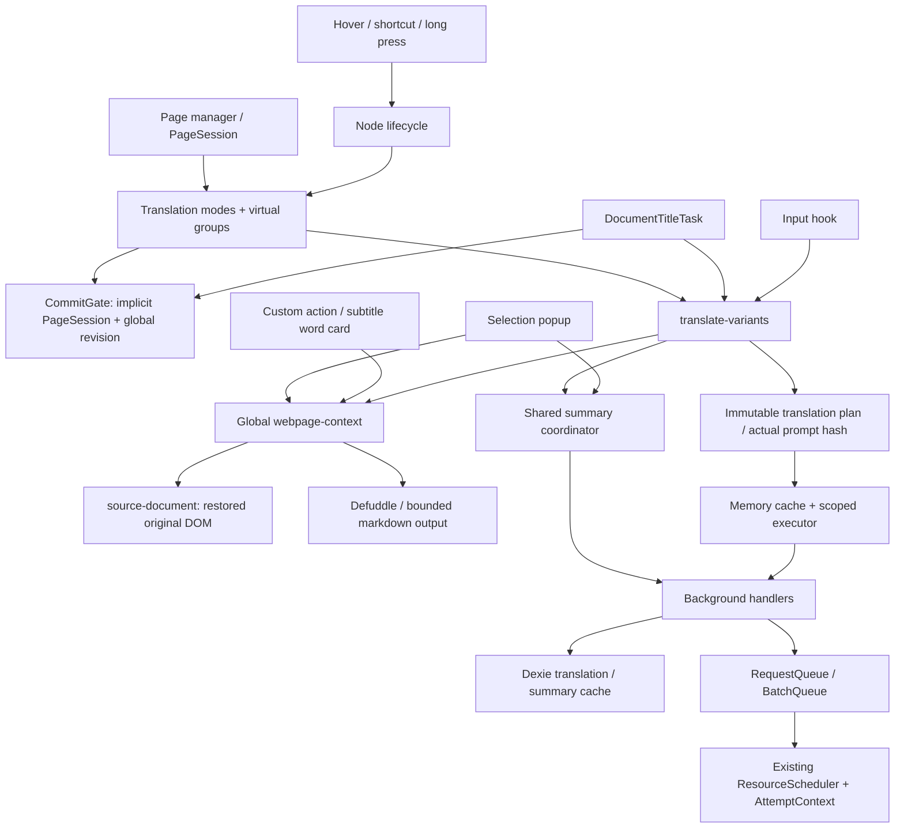
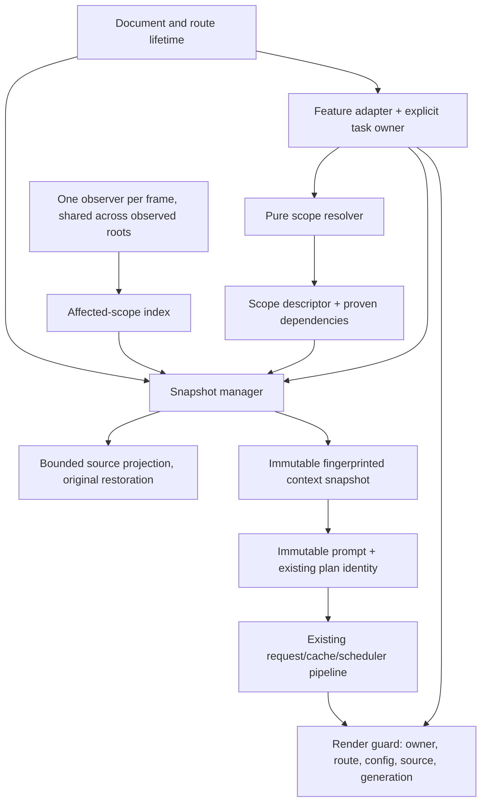

# Context Engine V2

## Production hardening of 7321d6f9

The latest fetched target HEAD equals `7321d6f9ada3a0335a876b2c076aebe4cdc4b0b5`.
This round retains V2 and all existing task/render/request owners. The original
implementation history below uses the earlier 1af30d16 baseline; its numbers are
not the control for this round. See [HARDENING_REVIEW.md](HARDENING_REVIEW.md).

Mutation records now queue **validation candidates**, classified as source,
semantic boundary, visibility/privacy or unknown. `class`/`style` stay observed.
The observer performs no projection, parser work, summary RPC or translation HTTP.
Only a demanded read or `isCurrent` checks a candidate. Irrelevant changes keep
both the snapshot object and content identity. No ContextValidity result enters
RenderValidity, and no Provider attempt budget changes.

Projection and validation share the same bounded original-source walk. Validation
computes a structural/content/eligible-source fingerprint without cloning live DOM.
Style eligibility is memoized within each walk. Class names are not guessed from
naming conventions: a class-only change is checked with the actual existing parser
against bounded detached source, retaining at most 64 KiB serialized markup per
projection. Probe markers exist only in this detached validation representation;
they are removed before parsing and never enter a prompt or persistent identity.
Parser-sensitive changes reproject on demand. Oversized markup or an ambiguous
HTML round trip uses conservative extraction; it does not silently accept old data.
Counters distinguish live `projections`, `metadataProjections`, `validations`,
`validationNodes`, `styleReads`, `semanticParses`, actual identity `rebuilds` and
candidate `invalidation.invalidations`. Equal actual model fields retain identity.

Metadata checks track only requested fields and the chosen heading. Eligible
Article/Document title consumers register head as a potential dependency so that
removing their local heading can safely fall back to later document-title changes.
Feed items do not inherit global metadata. Before an asynchronous preparation is
published, queued records are flushed and candidates verified; detached roots are
rejected. The final verification and cache publication have no intervening await.
Source churn retains the existing two-preparation maximum; candidate-only churn
coalesces into the pending single-flight extraction.

Collection affiliation is a WeakMap from member to a descriptor with a WeakRef to
its current parent and the parent's tag/role/itemtype/itemid/id signature. Reordering
or deleting peers retains proof for the last survivor in that same container.
Changing parent or semantic signature requires fresh explicit/structural proof.
Unlabelled main/body boundaries cannot become feed items just because they contain
a bookmark. Runtime parent/root IDs never participate in persistent prompt hashes.
There is no permanent strong item set, whole-feed scan or new observer per item.

### Context Visibility Policy

At capture/observed-mutation validation, exclude form/editable/embedded sources,
`hidden`, `aria-hidden=true`, `inert`, computed `display:none`, `visibility:hidden`
or `collapse`, exact `opacity:0`, and `content-visibility:hidden`. Check the source
and bounded ancestor chain including open ShadowRoot hosts. Foreign browsing-context
nodes and extension shadow/UI ancestry cannot grant source access. Preserve original
translation swap restoration, ordinary SVG text and sanitized nested non-HTML text.
Never read input values or traverse frame documents/closed shadow trees.

Nonzero opacity, `content-visibility:auto`, offscreen paragraphs and clip/clip-path
accessible text are retained. This is an explicit eligibility policy, not a claim
to solve every visual occlusion or every accessibility rule. No geometry-wide scan,
per-pixel test or periodic full-page style scan is performed. Stylesheet DOM edits
queue acquired scopes; CSSOM edits, animation progression without a DOM mutation,
media-query/font-load changes and cross-scope relational selectors are not fully
tracked. Previously captured immutable prompts are never changed retroactively.
These limits and native acceptance conditions are in RISK_REGISTER.md.

## Original V2 stage 0: audited baseline

Target `codex/subtitle-engine-v2`; fetched HEAD and baseline are both
`1af30d16e66871ebb3509a76f0df62aaa090c263` (0 commits / 0 files difference).
The preceding, uncommitted patch round was removed before this work.

### Existing dependency and ownership graph

| Caller                             | Context dependency / identity                             | Cancellation owner                                                           | Final submission                                                      |
| ---------------------------------- | --------------------------------------------------------- | ---------------------------------------------------------------------------- | --------------------------------------------------------------------- |
| Page bilingual / translation-only  | Global URL cache; actual prompt in plan hash              | Captured PageSession                                                         | Global revision, config, source / wrapper / generation                |
| Virtual / giant paragraphs         | Same global context for every unit                        | Implicit PageSession                                                         | Per-group or per-run source guards plus global revision               |
| Manual node translation            | Same page API despite node registry                       | Node DOM tracking but implicit page request owner                            | Same CommitGate; full-page cleanup removes manual wrappers            |
| Title                              | Global metadata / optional body                           | Title request plus PageSession                                               | Request counter + global revision; no direct title equality at commit |
| Selection popup                    | Unconditionally extracts whole document                   | Stream controller; extraction has no signal; summary defaults to PageSession | Popup run ID                                                          |
| Input                              | Page prompt requirements; independent summary consumer    | Document fallback; no hook lifetime passed                                   | Connected input + same trimmed text                                   |
| Custom action / subtitle word card | Unconditional whole-page extraction                       | Boolean ignores results; does not cancel extraction                          | Effect key / popup session; any context error becomes null            |
| Background translation             | Frozen provider, language, terms, prompt, context, format | Scoped subscribers in existing queues                                        | Cache validation and owner cancellation                               |
| Subtitle Session / Coordinator     | Video / track / policy / lease identities                 | Explicit session tasks and live leases                                       | Epoch, cue hash, policy, source index; no webpage revision dependency |
| Translation Hub                    | Explicit input and prompt snapshot                        | Card request ID / AbortController                                            | Card request ID; no webpage context dependency                        |

Audit includes all production callers of `getWebPageContentRevision`,
`getOrCreateWebPageContext`, `getOrGenerateWebPageSummary`, `captureCommitGate`,
and `isWebPageContextCurrent`. The existing plan hashes actual prompt contents;
runtime DOM IDs must never enter that persistent identity. The current additional
AI-aware context hash components are retained for compatible cache reads.

## V2 module boundaries

No render guard reads context freshness. Scope invalidation only affects future
snapshot acquisition. An issued prompt retains its captured context. Owner exit
releases that consumer; shared work cancels only after its last consumer leaves.

- Resolver: on-demand ancestor inspection, semantic landmarks, repeated item
  structure and stable links; no domain rules and no inferred conversations.
- Snapshots: immutable requirements + source fingerprint; bounded LRU and bounded
  extraction. Stable cache identity comes from actual model input, not root IDs.
- Invalidation: batch MutationRecords, index registered roots and explicit quote
  dependencies; reconcile moves after the batch, release detached scope entries.
- Task ownership: page, node, title, popup and input are explicit independent
  lifetimes under a document/route identity. They can share context subscriptions.
- Commit guard: reports owner-ended, route-changed, source-changed,
  source-detached, render-superseded or config-changed. Context freshness reports
  context-stale separately.
- Summary policy: demand-driven; no automatic per-feed-item model fanout.
  Short scopes can supply their complete deterministic source. Explicit model
  summary requirements that would exceed the existing route budget must produce
  an actionable consent requirement, never empty context or silent extra calls.

## Implementation gates

0. Audit, legacy failing contracts, reproducible performance baseline.
1. Resolver, snapshot identities and bounded invalidation; isolated tests.
2. Explicit ownership and render guard; failure reasons and source protection.
3. Integrate page/node/title/selection/input/custom entry points.
4. Verify cache equivalence, summary admission and real HTTP costs.
5. Full regression, stress tests, Chromium/MV3 feasibility, production build.

Status and measured evidence are maintained in TEST_REPORT.md and PERFORMANCE.md.

## Implemented contracts and budgets

| Identity          | Owner / implementation                                                                                    | Persistent cache participation                                       |
| ----------------- | --------------------------------------------------------------------------------------------------------- | -------------------------------------------------------------------- |
| Document / route  | `context/document-lifetime.ts`: document nonce, route epoch, abort signal                                 | URL only when actually requested by a prompt; runtime nonce excluded |
| Context scope     | `context/scope-resolver.ts`: weak root identity and proven explicit references                            | Excluded                                                             |
| Context snapshot  | `context/snapshot-manager.ts`: requirements and actual field fingerprint                                  | Actual used fields enter the existing request plan                   |
| Translation unit  | Existing source text/node snapshots and HTML/inline-atom protocols in translation modes/state             | Prepared original text, format and newline semantics                 |
| Task owner        | PageSession, independent node ResourceScope, popup AbortController, input task owner, title request epoch | Excluded; subscriptions still share equal requests                   |
| Render generation | Existing bilingual state, virtual group and translation-only generation                                   | Excluded                                                             |

The production manager retains at most 128 snapshot entries; idle LRU entries are
evicted, active entries are not stolen. Each entry expires after five minutes.
At most 128 extractions can be pending, including overlapping generations of one
root. Overflow reports ContextCapacityError. Source churn permits one local
preparation restart (two total preparations); this layer cannot issue HTTP.
A shared ContextCoordinator keeps consumers independent. Route end and explicit
release clear snapshots, registrations and shared work. A stalled dynamic import
can retain its admitted extraction until it settles; admission prevents additional
unbounded extraction, and no network translation is started for it.

Resolver limits: 64 ancestors, 96 element probes, 12 siblings and four explicit
same-document quote/up references. Every opaque semantic child consumes a probe;
TreeWalker filtering cannot silently scan an entire giant collection. Body
projection is limited to 2,048 nodes / 2,000 source characters per root, with a
shared 2,000-character final output and a one-third budget for explicit references.
Heading projection separately allows 256 nodes / 512 characters. Sanitized
ancestor privacy checks stop after 64 levels and fail closed beyond that boundary.
No input values, other frames, closed shadow trees, script/event attributes or
extension translation UI are projected. Original translation-only text restoration
continues to use the existing swap ledger. The legacy full-document projection
remains available only for legacy callers; V2 never requests its infinite budgets.

The invalidation engine has one MutationObserver per manager/frame, including
acquired open shadow roots. Records walk ancestors into a weak root index. Removal
and inherited visibility checks inspect only the bounded registered set. Reorders
retain scopes, detach drops entries, explicit quote rebinding creates a fresh entry
epoch. That epoch prevents the shared coordinator from resurrecting an evicted
snapshot under a reused key. Global metadata is a dependency only for scopes that
actually use it; a feed item does not inherit document metadata after its last
sibling disappears.

Render validation exposes typed reasons and bounded aggregate counters through
`getRenderInvalidityDiagnostics`; it retains no source text or DOM references.
Mode-specific source, wrapper and group checks remain authoritative and report
failure through the gate. `context-stale` belongs only to snapshot acquisition.
The old `documentRevision` wire/provenance field remains for compatibility and
inspection, not cancellation or cache identity; there is no global revision timer
or global stale-prompt resend loop.

## Feature integration and independent audit conclusions

- Page modes and virtual/giant groups pass their source, captured config and owner
  into request preparation. No global prefetch of the entire feed precedes them. The old metadata/title priming method, no-op context priming function and contextPrimed flag were removed; even page startup waits for actual prompt requirements.
- Manual hover/shortcut/long-press entry points use the existing node lifecycle
  registry with an independent owner. Page Stop cleanup preserves their registered
  render state; node detach and explicit manual cleanup still dispose it.
- Title tasks validate the original source title, own request epoch and route/page
  owner. Unrelated body changes cannot reject a valid title response.
- Selection uses the captured range/source and popup signal, never a later live
  selection. Spanning unrelated scopes degrades to captured selection text.
- Input uses its own owner, feature semantic config guard, connected editor and
  original-text guard. The source is rechecked after context preparation and before
  enqueue. Hook unmount or disabling the feature cancels its subscription.
- Custom actions calculate requirements across system prompt, user prompt and
  output field descriptions. Preparation errors remain visible, closing releases
  preparation, and transport changes invalidate results even with the same provider
  ID. Subtitle word lookup without a DOM source uses captured independent cue text.
- SubtitleSession / TranslationCoordinator and Translation Hub have their own
  session/epoch/cue or card-request guards, with no webpage context-revision
  dependency. Their architecture and retry/limiter policies are unchanged.

Partial subtitle cache recovery still accounts for uncovered members; the existing
coordinator permits one cache read in flight, releases the urgent window after at
most one frame, stops waiting at its configured timeout, and checks session validity
before consuming a late result. A permanently pending IndexedDB operation cannot be
physically cancelled by JavaScript; no new DB-recovery claim is made. Background
page cache reads still check cancellation after an awaited lookup before enqueue.
These boundaries were inspected and their existing regression tests ran; they were
not rewritten as part of V2.
