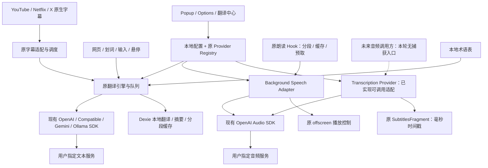

# Read Frog Lite 0.2.0 恢复与独立性报告

本轮依据新的“功能恢复、去官方化与统一服务接口”要求执行，优先复用上游成熟实现。上游固定为 Read Frog v1.54.1 / `aa6d54d1b9fde901fa7dbc00540a196fd28cd388`。保留 Lite 0.1 分支 `codex/read-frog-lite`（`11956229`），在 `codex/read-frog-independent` 工作。没有修改官方远程仓库，没有合并或发布 Release。

## 1. 恢复与代码来源

下表路径均相对于 src；逐文件来源与原导入依赖见 phase1-files.json 至 phase4-files.json。它们记录上游审计事实，出现旧私有包名称不表示最终仍依赖该包。

| 功能                                   | 上游真实文件 / 目录                                                                                                          | 本轮处理                                                                                                                                      |
| -------------------------------------- | ---------------------------------------------------------------------------------------------------------------------------- | --------------------------------------------------------------------------------------------------------------------------------------------- |
| 网页 / 双语 / 仅译文 / 恢复 / 悬停段落 | utils/host/translate、entrypoints/content-runtime/host                                                                       | 延续 Lite 保留的原引擎、DOM 边界、动态页面、调度 / 取消 / 缓存 / 站点规则；接回术语                                                           |
| 输入翻译                               | entrypoints/content-runtime/selection/input-translation/use-input-translation.ts、entrypoints/input-injector.content/editors | 恢复三次空格、原编辑器桥接与避免覆盖新输入，移除遥测 / Hosted 错误分支                                                                        |
| 浮动按钮                               | entrypoints/content-runtime/side、entrypoints/options/pages/floating-button                                                  | 恢复拖动、锁定、长按、点击动作与站点设置，排除官方入口                                                                                        |
| 术语表                                 | utils/glossary、entrypoints/background/glossary.ts、utils/db/dexie/tables/glossary*.ts                                       | 恢复本地 CRUD、CSV、匹配、目标语言 / URL 范围、Prompt 注入、修订驱动缓存失效；不接云同步                                                      |
| 自定义 AI Actions                      | entrypoints/options/pages/custom-actions、utils/custom-actions.ts、types/config/selection-toolbar.ts                         | 恢复编辑 / 自动保存 / Prompt / Provider / schema / 图标 / 排序 / 快捷键 / 复制删除 / 固定；独立字段渲染，不依赖 layout-engine 或 Notebase     |
| 翻译中心                               | entrypoints/translation-hub                                                                                                  | 恢复多服务卡片、Prompt、语言、重试 / 复制 / 朗读；默认只调用当前页翻译服务，多服务由用户显式选择                                              |
| 原生字幕                               | entrypoints/subtitles.content、utils/subtitles、entrypoints/interceptor.content、entrypoints/netflix-interceptor.content     | 恢复 YouTube timedtext / player response、Netflix TTML、X 原生 TextTrack；复用平台适配、调度、同步、双语 / 仅译文、换轨、样式、缓存、导出 SRT |
| 字幕辅助                               | subtitles.content/learning、ui/subtitles-sidebar、utils/subtitles/video-summary.ts、processor/ai-segmentation.ts             | 保留查词、按住暂停、时间跳转、字幕摘要与重分段，调用用户字幕 Provider；无云笔记 / 学习账户                                                    |
| TTS 主体                               | hooks/use-text-to-speech.tsx、utils/tts-playback、entrypoints/background/tts-playback.ts、entrypoints/offscreen              | 复用队列、分段、预取、缓存、停止 / 替换与 offscreen 播放；去 Edge 在线 transport / 遥测                                                       |
| TTS 分段                               | 原 utils/server/edge-tts/chunk.ts → utils/tts-playback/chunk.ts                                                              | 复用 GPL UTF-8 分段算法及测试，保留 1800 字节 / 60 段限制；仅替换常量 / 错误类型引用                                                          |
| 音频设置                               | entrypoints/options/pages/text-to-speech                                                                                     | 复用原语音设置、语言选择、语速输入和预览；在线 Edge Voice 目录改为服务定义的 Voice 输入；移除无对应 OpenAI 参数的 pitch / volume              |

必要的新代码：`utils/providers/audio/types.ts`、`openai-audio.ts`、`entrypoints/background/speech.ts`、最小 ASR 设置页及共享音频配置段。原官方 ASR 是“视频 URL → 官方任务 / 配额 / 轮询”，无法复用为用户音频 Blob 接口；新适配直接使用已安装的 `@ai-sdk/openai` Speech / Transcription 模型 API，没有手写 multipart、另造 HTTP 协议或引入插件框架。

语言数据替换、YouTube URL 提取与校验、HTTP 协议 / 凭据安全测试、浏览器 E2E 和 CI 为必要的独立性 / 兼容性工作。普通 Action 图标现在使用打包的本地集合；任意 Iconify CDN 名称不再在线获取。原专有 layout-engine 的 AI 布局生成器未恢复，基础自定义 Action 可独立使用。

## 2. 服务架构与实际边界

Translation、Speech、Transcription 独立选择 Provider / 模型，端点、Key 与自定义请求头复用原 Provider 行。删除服务后清空关联选择，不自动切换网络服务；禁用服务保留配置但不可调用。Lite 0.1 配置直接补默认字段，音频选择初始为空。所有配置和缓存本地保存，不迁移官方账户数据。

TTS 已接入真实播放链路；ASR 已实现 SDK 请求与响应规范化，**尚无网页音频捕获 / 自动转录 UI**。原字幕适配器的可选 source/fetcher 生命周期边界保留，但生产平台没有 AI fetcher，不能用它发起官方任务，也不能把这点当成 ASR 已接入视频。原 TTS 没有独立暂停后继续 API 或 SpeechSynthesis 实现，本次不补造，保留停止 / 再播放。

## 3. 协议兼容与验证范围

| 能力                          | 实际协议 / 实现                                                                                   | 已验证及限制                                                                                               |
| ----------------------------- | ------------------------------------------------------------------------------------------------- | ---------------------------------------------------------------------------------------------------------- |
| OpenAI-compatible 文本        | 现有 SDK Chat Completions                                                                         | 目标端点 / Header / Cookie / redirect 网络隔离测试；浏览器本地 HTTP 测试已配置 CI                          |
| OpenAI / Gemini / Ollama 文本 | 原 SDK 模型接口；OpenAI 原 Responses 行为保留                                                     | 四种 SDK 的自定义地址和凭据隔离自动测试；未向真实收费服务发送验收请求                                      |
| Speech                        | POST `/audio/speech`，Base URL 通常含 `/v1`；JSON model / input / voice / speed / response_format | 真实本地 HTTP 协议测试，MP3 / WAV MIME 校验与格式匹配；当前返回完整音频字节，非实时音频流                  |
| Transcription                 | POST `/audio/transcriptions`，SDK 生成 multipart；模型 / 音频 / 可选语言 / JSON 或 verbose_json   | 真实本地 HTTP 测试；SDK 校验响应；秒转毫秒，有限 / 非负 / end≥start；只有文本则返回空 segments，不伪造时间 |
| 字幕                          | 原 timedtext / TTML / TextTrack，SRT 导出、内部 WebVTT 重分段解析                                 | 原 fetcher、parser、scheduler、coordinator、export 回归；真实平台仍待人工测试                              |

音频共 14 个本地 HTTP 协议测试，包括未配置、请求字段、multipart、取消、超时、空数据、错误 MIME / 格式、非法 JSON / 时间戳、错误正文脱敏和重定向拒绝。25 MiB 输入 / 响应上限，默认 120 秒超时可配置。凭据放 Header，不放 URL / 请求正文。

Whisper 兼容服务仍需符合 SDK 的 verbose_json 结构；faster-whisper 封装可能省略 SDK 必需字段。Piper / Kokoro 原生协议未实现，只有提供相应 OpenAI-style 服务封装并满足模型 / Voice / 参数 / MIME 契约后才可尝试；未测试任何具体部署，不宣称天然兼容。自定义协议需要独立的小型 Adapter。

## 4. 官方依赖、网络与权限审计

没有登录 / OAuth / Better Auth / Session 查询、Billing / Pro / Ultra / 配额、Hosted AI / 官方转录任务、Notebase、FSRS、云同步、PostHog、运营轮询。生产源码、package.json 和锁文件不再引用 `@read-frog/*`。原始来源记录和 Git 历史保留上游归属，不是运行时依赖。

| 目的                                                  | 连接目标 / 触发条件                                                                                               | 数据                                                                                       |
| ----------------------------------------------------- | ----------------------------------------------------------------------------------------------------------------- | ------------------------------------------------------------------------------------------ |
| 文本翻译 / Actions / 摘要 / 重分段 / 已选 AI 语言识别 | 用户操作或用户已启用的自动翻译；对应已选 Provider 的 Base URL。未改端点时为 OpenAI、Google 或本地 Ollama 默认地址 | 待处理文本、语言 / Prompt；按已启用设置附网页上下文 / 字幕 / 匹配术语；Key / 自定义 Header |
| 模型发现 / 连接测试                                   | 用户在设置中主动点击；该 Provider 端点                                                                            | Key 和服务测试请求；没有定时模型抓取                                                       |
| 朗读 / Voice 预览                                     | 用户主动触发，并已配置独立 Speech 服务；相邻分段预取属于同一次播放                                                | 当前文本片段、模型、Voice、语速与格式                                                      |
| ASR                                                   | 仅音频 Provider 接口的显式调用；当前没有生产捕获调用方                                                            | 音频 Blob、模型、语言与输出格式                                                            |
| YouTube 原生字幕                                      | 观看匹配平台并请求原生字幕；只允许 HTTPS youtube.com / www / m 的 `/api/timedtext`，拒绝重定向                    | 视频轨道 / 原生 POT 参数；不附用户 AI Key；同源平台 Cookie 行为沿用浏览器原请求            |
| Netflix / X 原生字幕                                  | 原页面 TTML 捕获 / TextTrack 事件                                                                                 | 读取页面已有原生字幕；没有新官方 AI 请求                                                   |
| 文档 / 获取 API Key                                   | 用户主动点击服务商文档链接                                                                                        | 浏览器正常导航，不携带扩展 API Key                                                         |

图标 / 字体打包本地，Iconify 使用 offline 模块；Markdown 图片禁用远程加载。首次安装不打开云端引导 / 卸载调查。语言表由本地文件提供。未配置音频不会默认调用 Edge TTS。无官方服务中转。

文本 SDK、模型发现和音频请求省略 Cookie，拒绝重定向。服务端错误正文可能回显凭据，现只向 UI 输出安全状态信息；保留重试分类 / Retry-After，移除恢复模块的原始错误对象日志。API Key 存在扩展本地配置及隔离执行环境中，不放入普通网页 DOM / main-world 事件；配置导出默认去除 Key / headers。构建拒绝 WXT_*API_KEY 环境变量。

权限为 storage、tabs、alarms、contextMenus、scripting、webNavigation，以及恢复播放所需 offscreen。通配 host 权限服务于任意网页翻译和用户自定端点；没有 identity / cookies / microphone / tabCapture。定时 alarm 仅做本地缓存清理，无远程轮询。所有 HTTP 本地 / LAN 服务由用户选择，不升级为强制 HTTPS，网络安全取决于该服务部署。

## 5. 依赖与许可证

相对 Lite 0.1：runtime 增加 `react-markdown` / `entities`（字幕摘要 / 实体处理），删除 `@read-frog/definitions`；dev 增加 `lexical`（原富文本桥接测试）、`iso-639-3`（离线生成映射）、`@playwright/test`（真实扩展 E2E）。没有新的大型生产服务 SDK。

继续保留实际被使用的 AI SDK、React / Jotai / TanStack、WXT / webext messaging、Dexie、franc、Zod、原编辑 / 拖拽 / 样式依赖。`shadcn` 仍提供 theme.css 实际导入的 tailwind.css，不能仅因它是 CLI 名称删除。`ai` 的传递依赖含 gateway 包，但本扩展始终传已构造的用户模型实例，没有 Gateway 路由或密钥配置。

`@read-frog/definitions@0.11.0` 包元数据没有许可证，独立仓库许可证查询无法确认授权，因此完全移除，没有复制实现。179 种语言的标识 / 英文名来自 GPL 仓库 `src/locales/en.yml`；MIT `iso-639-3` 提供 ISO 数据，Node ICU/CLDR 提供标准别名 / 本地名 / 方向，`scripts/generate-languages.mjs` 可复现生成。YouTube URL 提取独立使用 URL API。原 GPL LICENSE、作者和历史保留，ZIP 内加入 LICENSE、NOTICE、第三方依赖通知及 ISO 数据许可证。部分公开依赖 npm 包没有根许可证文本，通知保留其声明的许可证 / 来源；这不等同于对所有传递包做法律结论。

## 6. 测试与构建结果

- 修改前 Lite 基线：类型 / Lint、173 文件 / 1830 测试、生产构建通过。
- 当前类型 / Lint 与全项目格式检查通过。
- 最终全量 Vitest：**259 文件、2541 项全部通过，77.87 秒**，使用 SKIP_FREE_API=true。控制台有原 jsdom 的 navigation 未实现提示，未造成失败，不将其冒充真实浏览器导航验收。
- 增加 / 恢复的覆盖：配置迁移 / 空服务 / 删除服务、术语、输入桥接、Actions、字幕获取 / 调度 / 导出、TTS 队列 / 替换、音频 HTTP、语言数据、YouTube URL 边界、错误凭据隔离。
- 中间回归曾暴露旧装配未提供朗读 Context、旧禁用 Provider 断言、短假视频 ID、错误原文显示断言，均修正并完整复验。音频取消在 Blob 读取期间发生时，补充 SDK 调用前的 AbortSignal 检查，避免发送已取消请求。
- Chromium MV3 生产构建与 ZIP 成功，精确数据和 SHA256 见 final-metrics.json。
- **本云端真实 Chromium 尝试未通过扩展加载阶段**：15 秒内没有 Service Worker；此前同环境明确拒绝 unpacked 加载（administrator policy）。没有绕过管理策略，没有把单元测试冒充浏览器功能通过。
- Playwright `e2e/extension.spec.ts` 使用真实 unpacked MV3、真实页面、真实本地 HTTP 服务，计划验证页面双语 / 仅译文 / 恢复、划词、输入、配置持久化、请求目标和 Key 隔离。协议服务是可控测试端点，不是对真实模型翻译质量的证明。CI 安装 Chromium，在 Xvfb 中执行，失败不跳过。
- Actions 使用只读 contents 权限、frozen lockfile、Node 24、pnpm 12.10.1；先测试 / 构建 / 上传 ZIP，再执行 E2E 和上传报告。无部署 / 合并 / Release。旧上游 Claude / 贡献者信任 / 自动标签 / stale 运营工作流已删除，Git Hook 从已删除 Nx 切换到实际脚本。

## 7. 构建指标

统计 src 全部文件（含测试 / 本地化 / 资源），直接依赖按 package.json 两类分别计数，生产目录逐文件字节相加。许可证通知现在也计入产物。

| 指标                   | 原版 v1.54.1 |  Lite 0.1 |   当前 0.2 |
| ---------------------- | -----------: | --------: | ---------: |
| src 文件               |         1592 |       621 |        991 |
| src 字节               |   12,898,408 | 3,733,210 |  5,869,475 |
| runtime / dev 直接依赖 |      93 / 41 |   54 / 34 |    55 / 37 |
| 生产构建字节           |   20,452,994 | 8,020,047 | 14,543,524 |
| ZIP 字节               |       未记录 | 2,546,305 |  4,598,035 |

大包对比（最终精确值见指标）：content-runtime 3,353,488 → Lite 2,095,432 → 当前约 2.51 MB；字幕 content script 原版 4,126,284 → Lite 删除 → 当前约 3.37 MB。background.js 原版 456,923 → Lite 149,865 → 当前约 58 KB，但共享 SDK 被分到 chunks，不能单独用 background.js 大小宣称整体后台成本降低。恢复功能后体积增加符合本轮目标；不声称未经浏览器测量的性能提升。

## 8. 尚未验证与后续边界

实际 YouTube / Netflix / X 登录态、站点近期 DOM 变化、长视频同步 / 导出、复杂编辑器、Chrome / Edge Service Worker 生命周期、声音设备与真实服务端部署仍需按 MANUAL-ACCEPTANCE.md 验收。当前没有确认的真实平台全覆盖结论；云环境加载失败也不能判为产品运行成功。

后续确需工作分别为：不符合 OpenAI 响应结构的 ASR 服务 Adapter；不同 Voice / 格式 / 参数的 TTS 服务 Adapter；获授权的视频音频捕获；实时流式转录。四者均未在本轮擅自实现。无暂停后继续、无私有布局生成器、无任意远程图标、无视频自动 ASR 入口属于明确的保留边界，不是用 Mock 冒充完成。

远程 PR / CI / Artifact 的实际结果将在交付时记录；已有本地阶段提交不依赖远程操作成功。
