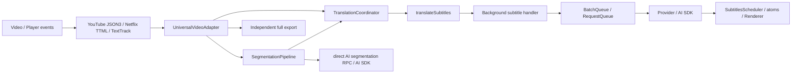

# 字幕升级审计与实施依据

基线 `bad35243`（UI 修复提交 `5a27691f` 不改变字幕实现）。旧源码与构建保存在 `/tmp/read-frog-subtitle-baseline`。基准将真实模块打包至 Chromium，模拟 Provider 耗时、无付费调用；不是原生 MV3。

## 旧调用链与所有权

| 所有者 | 已有职责 | 审计结论 |
|---|---|---|
| 平台 fetcher / track listener | 轨道选择、获取/解析、原生字幕模式恢复 | 保留平台实现；有视频/轨检查与广告处理，不重写 |
| UniversalVideoAdapter | 视频/源轨缓存、fetcher切换、UI、导航和操作版本 | 保留为平台边界；补齐所有异步恢复后的代次校验和会话资源归属 |
| TranslationCoordinator | 播放监听、附近批次和翻译状态 | `runId` 已能拦截部分旧翻译，但后台请求不可取消；start键冲突，seek不能让新位置越过旧批次 |
| SegmentationPipeline | 原文数组和AI窗口替换 | `running/stopped` 对 stop→start 不安全，后台AI绕过网络队列 |
| SubtitlesScheduler / atoms | 当前译文、整轨与显示回退 | 多处线性查询；批量更新对每个cue做findIndex；同cue React更新已被Jotai稳定引用抑制，不能虚报优化 |
| RequestQueue / BatchQueue | 令牌桶、重试、去重、引用计数取消 | 成熟基础设施，直接复用，不另造网络队列 |
| Downloader | 独立全量处理、并发2批、严格完整性校验 | 已有不完整导出拒绝和回退，保留；补后台取消和快照 |
| 摘要 | 播放翻译上下文摘要 + 独立侧栏流式摘要 | 两种用途分开；侧栏已有AbortController，播放摘要缺取消/拒绝处理 |

## 确认的问题

| 优先级 | 证据 | 处理方向 |
|---|---|---|
| P0 | SegmentationPipeline.stop仅改stopped；start重新置false，旧runLoop仍持有running | 每次运行唯一代次+可取消任务；旧finally不得释放新锁 |
| P0 | subtitle handler未传scope，AI segmentation直接generateText | sender.tab建立作用域，翻译/分段/摘要/导出均接入现有队列 |
| P0 | translator哈希await getSubtitlesTranslatePrompt，后台批次再次读存储 | 纯Prompt构造器+不可变请求计划；缓存与执行同快照 |
| P0 | 分段查找start>=currentTime-10s；35:00→35:40在35:20被跳过 | 区间查询覆盖当前cue，当前窗口优先 |
| P0 | coordinator.isTranslating整体阻塞Seek；旧任务先完成才排新任务 | 有界并发槽；远处任务取消，当前cue立即重排；相同身份pending复用 |
| P1 | starts Set/Map与scheduler/侧栏start键关联 | 使用id/start/end/text/sourceLanguage身份，保留重叠/同开始时间cue |
| P1 | 单条失败转translation=""，协调器记translatedStarts | 区分结果状态，失败不缓存；有界冷却重试，保留原文 |
| P1 | 大数组find/findIndex/sort与复制重复 | 简单有序区间索引+identity Map；按轨版本重建，批次合并一次 |
| P1 | videoContext.summary被异步原地改动、summary promise无catch | 每批拍快照，晚到摘要仅影响后续计划；不阻塞当前句 |
| P1 | transcript所有行DOM映射且key=start | 先度量，再做必要可见窗口与稳定身份；保留跟随意图 |
| P2 | TextTrack元数据hash无法唯一识别同标签轨对象 | 補轨对象身份并保留原生模式恢复测试 |

## 升级边界

SubtitleSession负责视频/轨代次和任务租约，Playback coordinator负责按位置决定做什么，CueTimeline负责区间/身份查找，纯SubtitleTranslationPlan负责请求语义，原有队列负责什么时候能请求。播放、分段、上下文摘要和导出使用独立取消作用域；多使用者同请求沿用队列引用计数。渲染不拥有模型请求。

当前cue优先于未来cue，先查覆盖当前位置的区间；监听metadata/data/seeking/seeked/playing/timeupdate/ratechange。连续seeking合并短调度回合，seeked即时执行；首次0s不等待猜测性的播放器恢复，后续位置变化立即重排。保留本地原文/规则分段作为无AI结果时的回退。

AI分段/Prompt/上下文质量维持现有文本和规则，新增窗口策略需做文本覆盖及时间轴对照测试。已发送远程请求只尽力中止，不能保证供应商停止计费。

## 基线

`before/raw.json` 保存100/1000/10000/50000规模的实际浏览器lookup、timeupdate各30个批样本，每样本200操作；批量500cue提交10样本；12种恢复/Seek/倍速/停止场景各30次。原始任务事件记录enqueue/execute/complete/cancel及起点。初步结果确认旧实现恢复35:20已从附近启动，不能声称它总会翻译全部历史；实际缺陷是先选历史几条、长cue分段漏选、旧批次阻塞Seek，以及停止后请求继续完成。
