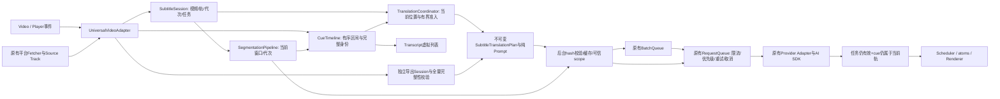

# Read Frog Lite：UI收尾与字幕架构升级交付

后续发布前边界修复见[最终边界审查](../lite/RELEASE-BOUNDARY-REVIEW.md)：字幕批量持久缓存已改按实际整批 Prompt 标识，Popup 导航与并发确认已补齐；真实 MV3 验收仍受策略阻断。下文保留上一阶段交付记录。

本轮已实现UI修复、字幕生命周期与请求一致性、时间轴索引、当前位置调度、失败恢复、长列表虚拟化及完整导出校验。代码位于本地分支`codex/subtitle-session-upgrade`。按本轮指令不推送远程、不合并main、不创建Release、不修改或触发GitHub Actions。

## 1. 基线与范围

开始时工作区干净，HEAD为`bad35243a594b01a588fed3eee7a20a63da327d2`，与远程`codex/popup-ui-performance`一致。只将历史提交作为对照，没有回滚或覆盖后续成果。初始远程main为`18f2c8cbfddc3df5e4b7552a48b1731c28ac4cfd`，翻译架构分支为`bb14e8bb14c06cfa8abe24f54a6b0505e46880e5`。

完整旧架构与证据见[AUDIT.md](AUDIT.md)。阶段记录见[PHASE-0](PHASE-0.md)、[PHASE-2](PHASE-2.md)、[PHASE-3](PHASE-3.md)、[PHASE-4](PHASE-4.md)、[PHASE-5](PHASE-5.md)。性能、样本量、分位数和所有收益/退化见[PERFORMANCE.md](PERFORMANCE.md)，机器可读汇总为[summary.json](summary.json)。

## 2. 问题清单与处理

| 等级 | 确认的问题                            | 最终处理                                                                                      |
| ---- | ------------------------------------- | --------------------------------------------------------------------------------------------- |
| P0   | 存储false先于页面管理器停止           | Popup经后台直达top-frame，等待原有manager命令完成；导航/超时/迟到回执均有校验，手动禁用先落盘 |
| P0   | Switch首个越过阈值的move丢位移        | 保持按下锚点，在首次move应用位移，保留Base UI/CSS语义                                         |
| P0   | 停止字幕只拦截结果，模型仍运行        | SubtitleSession任务作用域下沉现有队列；sender.tab建立可信范围，最后订阅者退出才abort          |
| P0   | stop→start分段旧finally释放新锁       | 运行代次和任务身份共同校验；旧结果/旧finally不能修改新运行                                    |
| P0   | 长字幕覆盖当前时间却被start比较漏选   | 区间索引找到覆盖当前位置的cue，分段选择覆盖当前时间的规范窗口                                 |
| P0   | Seek等待旧整体翻译批次                | 同回合合并事件、取消远处任务，当前cue重新入队                                                 |
| P0   | 哈希使用旧Prompt，执行重新读配置      | 纯Prompt构造与不可变请求计划，执行/缓存共用同一快照；兼容旧消息                               |
| P1   | start单独作为cue身份                  | 使用id/start/end/text/sourceLanguage；重分段后按完整身份剔除旧译文                            |
| P1   | 失败写成空成功且不再恢复              | 显式结果类型、跨RPC结构化失败、有限冷却恢复，原文仍可见                                       |
| P1   | 配置/术语变化后旧结果回写             | 语义配置和术语revision watch销毁旧会话，从当前位置重启；样式不重启                            |
| P1   | AI重分段前预译未来cue后丢弃           | 当前原文立即翻译，未来cue等该窗口分段完成再译；分段失败保留规则回退                           |
| P1   | 数组反复扫描和逐条findIndex           | CueTimeline、批次Map更新和线性有序合并                                                        |
| P1   | 长Transcript全量挂载/所有行重建       | 未变行复用引用，超过200条采用可变行高虚拟列表                                                 |
| P1   | 相同数量但重复/错位结果可通过导出校验 | 每批身份多重集合核对、排序、有限时间戳校验，部分失败不下载                                    |
| P2   | 同标签原生轨及同数量cue编辑误用缓存   | 轨对象身份+完整cue内容摘要；清理使等待cue的轮询退出                                           |
| P2   | pagehide后BFCache恢复持有已销毁会话   | pagehide取消任务/摘要/导出；persisted pageshow重建播放会话                                    |

## 3. 新架构与实际执行路径

实际接管入口是Adapter创建并传入的Session，Coordinator和Pipeline登记任务，translator构造请求计划，后台处理器将同一scope交给已有BatchQueue/RequestQueue。不是额外空壳调度器。原有网络队列、Dexie、Provider和AI SDK均保留，没有复制DOM翻译引擎。

Adapter拥有源轨、平台监听与配置watch；Session拥有任务取消与运行代次；Coordinator决定当前位置要做什么；Pipeline拥有分段窗口和发布版本；Scheduler只管理显示轨；Renderer不发起模型请求。侧栏完整视频摘要保留独立流式AbortController，播放上下文摘要是Session内context任务；SRT导出是独立Session，普通字幕开关不会取消它。导航、销毁和pagehide会清理相应视频的工作。

## 4. 生命周期与回写规则

每个播放、分段、上下文或导出任务有独立UUID作用域和AbortSignal。后台将其与可信sender.tab.id结合；跨标签取消不能由前端伪造tabId。取消标记先于队列初始化/缓存await登记，避免请求逃过取消窗口。已有共享请求引用计数保留，取消一个播放订阅不会杀掉仍由导出/另一标签使用的请求。

回写必须同时满足任务仍在当前代次、未取消、结果cue在原请求中、该完整cue身份仍在当前轨。配置变更、轨切换及重新分段不能借旧start复用错误译文。旧异步finally只清理自己登记的pending集合/锁。扩展上下文失效退出，取消不进入无限重试。

请求取消只能尽力传递给网络/AI SDK。远端已经接受的请求是否停止计算或计费，扩展无法保证。

## 5. 不可变计划、Prompt与缓存

请求快照覆盖Provider完整配置、源/目标语言、选择的模板、标题/描述/摘要、术语命中与revision。计划深拷贝并冻结；批次执行与单条回退共用纯Prompt构造器。缓存键包含准备后的原文、Provider语义、语言及实际渲染Prompt；位置、调度优先级、取消UUID、消息返回格式不进入语义缓存键。

源轨/cue身份的提交校验在Session/Coordinator完成，不依赖后台返回时间戳。后台校验新请求的语义hash，旧版本消息只在接入时读一次配置并重算hash。摘要晚到只影响未来批次，不篡改已排队的上下文。模板没有VIDEO_SUMMARY依赖时不生成播放上下文摘要；摘要失败继续用现有上下文。

翻译和已验证的分段缓存命中直接返回，不占模型令牌。分段缓存含实际Prompt、规则版本及16384输出预算，并检查文本/时间轴对齐。该预算是本次显式传入；旧代码只有相关注释，不能宣称过去已保证同值。失败/空的非空原文结果不写成功缓存。成功缓存不因UI模式变化整体清空。

## 6. 调度、背压与失败恢复

当前覆盖cue优先，其次未来数秒、前瞻窗口，再到摘要/导出。最多2批×5条播放cue和1个分段任务；窗口按1–4倍速扩大。已有网络队列维持用户配置的令牌桶、429暂停、重试和超时，字幕任务每等待30秒改善一级，辅助工作不会被持续新cue永久饿死。不能抢占已开始的共享模型调用；跨任意标签的全局队列没有新增硬上限，每个生产者有界。

事件包括metadata/data/seeking/seeked/playing/timeupdate/ratechange；同回合Seek合并，不等待猜测性的“播放器恢复稳定”超时。若先0秒、后异步恢复35:20，已经发出的0秒请求尽力取消，35:20立即进入下一次准入。

分段用规范约60秒窗口，必要时延长到本地基线cue边界以避免剪断原文。当前可见原文无需等待AI；未来字幕不在即将重分段时提前浪费翻译。缓存命中/预分段轨直接复用。失败、无可生成文本Provider时回退现有本地规则。

成功、合法空原文、暂时失败、永久失败、取消分开。现代Content Script通过结构化RPC保留错误分类/Retry-After，旧脚本保留字符串协议。暂时失败先经过原有网络重试，再冷却至少30秒或Retry-After，自动额外恢复最多一次；永久失败等待显式重启或配置变化。成功邻居不重译，失败保留原文，手动重新启用可重置失败状态。

## 7. 时间轴与长列表

CueTimeline使用稳定start排序数组、prefix-max-end数组和身份Map。第一条覆盖当前时间的查询O(log n)，支持长cue、重叠、反向Seek、同开始时间；窗口查询O(log n+扫描候选数)，病态重叠最坏O(n)，没有声称所有区间都对数复杂度。值更新O(n+m)，插入批次O(n+m log m)，不会每条结果findIndex再sort。轨数组按不可变发布约定缓存索引；结构改变重新建索引。

Transcript超过200条使用TanStack React Virtual 3.13.12，实际测量可变行高与overscan。只增加该包及virtual-core，没有新的AI框架。当前cue索引不变时不触发无意义React提交；原有基线这项也已为0。原有字幕样式、拖动、自定义CSS、双语/原文/译文模式不变。

保留用户滚动暂停跟随、点击行Seek和返回当前字幕。完整TranscriptSection浏览器功能8项通过。虚拟化仅挂载可见行，所以浏览器原生页面查找只能看到挂载文本；侧栏原来没有独立全文搜索接口。完整导出不受可见窗口影响。

## 8. 实际顺序与性能

所有详细样本和P50/P95见[PERFORMANCE.md](PERFORMANCE.md)。以下是sample 0的真实浏览器mock事件，时间相对场景启动：

- 恢复35:20：旧版先分段35:10、翻译35:14起的5条；新版先请求覆盖35:20的35:00规范窗口，约1.8ms即入队35:20当前原文。约63ms分段完成后才翻译未来重分段cue。
- 5:00→40:00：约5.3ms取消旧位置翻译、5.4ms取消旧分段，5.4ms排40:00分段，5.5ms排40:00当前翻译。旧版目标翻译约41ms才入队，目标分段约61ms才入队。
- 35:00–35:40长cue、当前位置35:20：旧版分段从35:40开始漏掉长cue；新版分段和当前翻译均包含35:00开始的覆盖cue。
- stop→start：旧版保留旧模型请求；新版取消旧翻译与分段，再以新代次入队，旧返回不发布。

主要实测：50,000条查询P50约34→3µs，500条合并23.9→0.3ms；Seek后首个目标结果约76→41ms；50,000行侧栏挂载P50约2858→117ms，末行附近DOM从50,000行降至14行。当前任务排在辅助任务后时，真实队列的Provider开始P50约807→201ms。单纯首条恢复字幕仍约41ms，主要由mock模型40ms延迟决定，未虚报所有场景都提速。

真实队列72条测试仍8次Provider调用、平均9条/次，批利用率未下降；停止在途调用的30组样本从30次继续完成降至0次。Coordinator内容批数因减少重分段前的无效翻译下降，但它们不是HTTP调用数，不能直接换算API节费。

## 9. 质量、平台与导出验证

现有Prompt和本地优化器保留。新增英文/中文/日文/阿拉伯文对照，将恢复位置窗口的规则回退与全轨基线比较：1800个源标记完整、顺序一致、时间轴有效。AI结果仍经过文本与时间轴对齐校验，错位、缺失、异常时长和错误缓存被拒绝。未使用真实付费模型做语义评分，模拟文本保真不能冒充译文质量评分。

| 范围                                         | 验证方式与结果                                                                                       | 实站原生扩展验收                               |
| -------------------------------------------- | ---------------------------------------------------------------------------------------------------- | ---------------------------------------------- |
| YouTube/watch/Shorts/embed、字幕轨/广告/导航 | 既有fetcher、拦截、Shorts重建、广告隐藏/恢复、轨监听及销毁测试通过                                   | 受浏览器扩展安装策略阻断                       |
| Netflix TTML/轨轮询                          | 解析、源轨变更与轮询生命周期测试通过                                                                 | 未进行登录实站播放                             |
| X.com、原生TextTrack                         | 源轨过滤、懒加载、同名换轨、cue修改、模式恢复/清理测试通过                                           | 未冒充实站兼容认证                             |
| 会话/配置/上下文                             | 真实RequestQueue契约、跨标签、共享导出取消、过期快照、stop/start、pagehide/BFCache测试通过           | 真实SW生命周期待可安装环境验证                 |
| 侧栏/字幕UI                                  | 现有学习、拖动、模式、导航测试；真实完整侧栏8项功能检查                                              | Chromium受控页面，非原生扩展                   |
| SRT                                          | 100/1000/10000/50000条各3次完整导出，全样本无漏/重复/无效时间戳；取消/部分失败/换视频/AI回退专项通过 | 文件构造真实，浏览器保存动作在基准中替换为捕获 |

导出保持独立配置和双批并发，用户切换播放UI不会取消它。新增身份核对与排序使50,000条零延迟mock导出CPU P50约102→141ms；这是完整性成本，没有宣称导出吞吐提升。

## 10. UI收尾证据

Popup不再把提前存储false当成停止成功；manager完成回执、URL/导航版本、超时和迟到响应处理已落地，不新增一套翻译引擎。Switch首次大幅move立即应用位移，controlled/uncontrolled、反向/取消、触摸/键盘、disabled/readOnly、reduced-motion均有覆盖。

生产Popup en/zh-CN/zh-TW各冷/重复30样本、两版本共360次。修复后冷启动可交互P50分别387.0/414.2/412.9ms；语言chunk及P95见[UI原始汇总](ui-locales/summary.json)和[chunk数据](ui-locales/locale-chunks.json)。这是生产资源+模拟API，不能替代新增RPC的真实跨上下文开销测量。

## 11. 构建、检查与工程收敛

最终检查记录见[VALIDATION.md](VALIDATION.md)。执行时设置`SKIP_FREE_API=true`。生产构建保留React19/WXT/MV3，Manifest版本、权限、host permissions及注册方式保持；background.js仍无动态import。没有扩展ID、配置迁移或工作流变更。

替代了按start定位、逐条findIndex合并、不可取消的字幕入队、直接绕过队列的AI分段、重读配置的字幕Prompt执行及全量Transcript DOM路径。既有平台获取器、原生字幕模式、学习功能、Provider、AI SDK、Dexie、RequestQueue/BatchQueue保留。API payload新增字段向后兼容，不改变用户存储数据。

复现入口：`e2e/subtitle-harness/run.mjs SOURCE OUTPUT`；`BENCHMARK_KIND=transcript|queues|export|functional`选择子基准；`summarize.mjs`生成汇总。历史源码用git archive提取，旧生产构建独立保存，不checkout覆盖当前工作区。构建中实际Prompt/Provider使用现有配置形状，测试环境只注入合成配置。

## 12. 限制与未完成验收

- 本机Chromium管理策略`ExtensionInstallBlocklist=["*"]`阻止加载未打包扩展。没有绕过管理策略；原生MV3 Service Worker冷启动、实际Popup→SW→Content RPC，以及登录平台实站播放仍需在允许安装的环境验证。
- 所有性能数据来自真实Chromium与本地mock Provider。译文语义质量、真实供应商取消计费、真实网络长时429/慢模型行为无法由这些数值保证；相关控制逻辑有确定性契约测试。
- 索引/对象引用复用依赖不可变轨数组；病态大量重叠窗口仍可能线性扫描，规范分段窗口可为避免剪断超长cue而延长。每标签生产者有界，任意多标签总队列没有全局硬上限。
- 虚拟列表不保留离屏DOM供浏览器原生全文查找。新增包固定版本、frozen lock校验通过；renderer内存峰值来自重复挂载压力测试，不等同正常播放内存。
- 已完成可执行部分，以上验收限制没有被隐藏为“全部实站通过”。本轮未推送GitHub；所有提交使用`[skip ci]`标记，但它不是未来任何自动化触发条件下的通用禁用保证。

本地提交清单见[COMMITS.md](COMMITS.md)。
