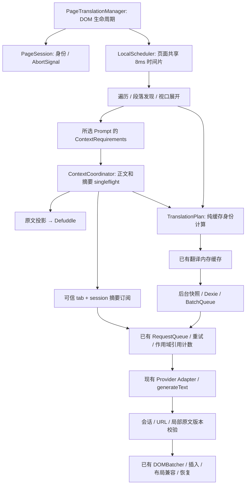

> 第二阶段已继续完成生命周期、请求执行、提交屏障与 Headless UI 接口。当前实现请先看 [第二阶段验收](./phase-2/REPORT.md) 和 [同机性能对照](./phase-2/PERFORMANCE.md)。下文保留第一阶段设计记录。

# 页面翻译架构与维护契约

本轮从 `18f2c8cb`（干净工作区）渐进升级。WXT/MV3、AI SDK 完整 `generateText()`、Provider 协议与自定义参数、RequestQueue/BinaryHeapPQ/令牌桶、BatchQueue、Dexie、Defuddle、术语表以及 DOM 恢复机制继续使用。未增加框架、后台队列或持久存储迁移。

## 模块关系

`translation-session.ts` 是帧内请求身份与 AbortController 的唯一所有者，以 `idle | active` 判别联合表示状态。Manager 仍负责观察器、DOM 和标题生命周期；正文 revision 由 `webpage-context.ts` 管理，原文区域的局部版本继续由既有 translation-state 和 Manager 管理。分开这些版本，避免每次局部修改都使整篇正文失效。会话记录启动配置；每个新请求读取当前版本的独立配置副本，因此进行中的请求稳定，新请求能使用用户刚修改的设置。

`context-coordinator.ts` 管理 pending/ready/cooldown；取消删除条目并回到 idle。每个消费者持独立订阅，最后一个离开才 abort 底层任务。清空、内容失效和会话停止都能立即拒绝订阅者；旧任务即使迟到也不能写回新条目。页面摘要按会话去重消息，后台继续跨标签去重和持久缓存。页面端的 Promise 协调器不承担网络速率或重试职责。

`local-scheduler.ts` 只预算本地展开。整个页面共用一个循环，前台/后台各一条 FIFO Map，每 4 次前台轮转允许后台前进。每步之后的微任务边界让消费者的同步准备工作计入下一次预算检查；不会一次放行整批 await。DOM 遍历、ShadowRoot 发现、段落注册、巨型段落和虚拟段落展开逐步让出主线程。网络 Promise 不阻塞调度循环，已有 RequestQueue 继续控制发送速率，其令牌容量不代表并发上限。删除无人使用的 WorkPacer/createWorkPacer 路径；保留 `yieldToMain` 的 scheduler.yield、postTask、MessageChannel、timer 回退，MessageChannel 结束时关闭双端口。

`translation-plan.ts` 将标准化上下文和缓存身份计算从 dispatch 分离。Provider、语言、上下文和所选模板在异步准备前复制；术语匹配结果/revision 只解析一次并随消息发送。后台按完整 Provider 快照、Prompt 配置和术语 revision 分批，用同一模板快照构建批量与单项回退 Prompt。AI Adapter 直接从收到的配置构建模型，不再按 ID 二次读取可变配置。兼容老调用方的可选 Prompt 配置只在入口解析一次。

渲染职责继续落在已有 `DOMBatcher`、translation-modes、translation-insertion 和 translation-state。增加会话/URL 与仅译文提交的晚到结果门禁。保留浮动布局、脚注高度、公式/行内占位符、同步译文接续和宿主篡改恢复。浏览器用例没有证明需要重写布局测量，故没有用抽象层替换成熟插入路径。

## 修复与规则

- 摘要异常到达 RequestQueue 后才决定重试。SDK `maxRetries: 0`；429 使用已有队列暂停、指数退避和 Retry-After；网络/超时使用普通预算；权限错误直接失败；取消不记为成功。
- 空正文返回 null；空或过长输出报错；信号在异步边界检查。失败不写 Dexie，终态失败进入短暂冷却，上层明确记录诊断并回退到无摘要翻译。
- 摘要输出设 `maxOutputTokens=2048`，最多 6000 字符，模型因长度停止也拒绝。原摘要 Prompt、正文提取与长文截取策略未改；预算是异常输出上限，不机械截断输出。模拟测试不能评价真实模型摘要质量，未来需经授权语料评测后调整预算。
- 摘要持久身份包含 `ARTICLE_SUMMARY_RULE_VERSION`、标题/正文身份、完整 Provider 身份。修改摘要规则、原文投影或提取规则时必须 bump 该版本；旧记录自然失去命中，不删除用户缓存。
- 后台用 `sender.tab.id` 和 sessionId 构造 scope，不接受 payload 内 tabId。一次订阅取消不影响其他标签；最后一个取消传递 AbortSignal。无 scope 调用使用独立任务 key，不能把 scoped 任务永久钉住。
- 标签 loading 导航标记并取消当时已有 scope；新文档 scope 不受影响。关闭标签走前缀取消，stop/pagehide/SPA 替换通过会话取消释放资源。
- 每个正文 revision 并发只提取一次。普通锚点保留上下文；路径、查询或 hash 路由变化使旧结果失效。宿主替换 body/main/article/role=main 的正文结构会增加 revision；普通段落编辑只更新局部源区域。
- 内容 revision 在摘要等待期间改变时，仍有效且未导航的消费者重新加入最新共享任务，避免未变段落被遗漏；停止/导航/Provider 错误不走这个重试。
- 正文提取使用脱离页面的原文投影，排除扩展译文、spinner 和 UI，并恢复仅译文模式中仍匹配翻译值的原文文本/属性。不会为提取而修改活页面，不覆盖宿主后来修改的文本。
- ContextRequirements 只检查所选 systemPrompt/prompt 模板中的既有精确占位符，不扫描原文。仅标题模板不提取正文、不发摘要；使用正文的模板继续提取；使用摘要且智能上下文开启才生成摘要。发现首个段落后预热共享任务，让扫描和上下文准备重叠。
- 翻译 hash 包含实际渲染 Prompt、完整 Provider 配置、语言、格式、保留换行选项和完整必要上下文；不再仅用正文前 1000 字符。保持已有术语内容身份及 revision 分批约束。
- Mutation 一批内以 Set 归集源区域和新增节点，WeakMap 复用同一源区域与 wrapper 的全文检查。同步译文接续仍在第一次 await 之前；异步恢复和最终落地继续验证版本。

## 数据结构、复杂度与释放

令 N 为访问节点数，R 为 MutationRecord 数，U 为受影响原文区域数，S 为这些区域文本总长度，P 为本地待处理任务数，C 为摘要/上下文条目数。

| 结构                                   | 替代的重复工作                   | 操作与内存                                                               | 失效/清理及取舍                                                                                                                                          |
| -------------------------------------- | -------------------------------- | ------------------------------------------------------------------------ | -------------------------------------------------------------------------------------------------------------------------------------------------------- |
| ContextCoordinator Map + Promise + Set | N 个段落各自提取/发消息          | 查找/引用增减均摊 O(1)；prune O(C)；O(C + 活跃订阅数)                    | 正文容量 2，摘要 settled 容量 16；冷却 TTL；pending 不驱逐，避免重复执行；stop/revision 清空。正文失效限制并发版本，摘要由页面需求限制，不另造后台队列。 |
| 后台 WeakMap<RequestQueue, Map>        | 失败后每段重新烧重试额度         | 查找均摊 O(1)；每队列最多 64 条                                          | 至少 30s、遵守更长 Retry-After 的终态冷却；队列 GC 后可释放；持久缓存仍是 Dexie。                                                                        |
| 两条 FIFO Map + 任务 Map               | 多个独立 pacer 同时放行          | 入队/去重/轮转均摊 O(1)，O(P)                                            | 完成或 current=false 删除；8ms 时间片和 4:1 公平轮转；现有视口观察提供需求背压。固定两级优先无需第二个堆。                                               |
| 迭代栈                                 | ShadowRoot/原文投影深递归        | 遍历 O(N)，最坏 O(N) 辅助内存                                            | 任务结束释放；本地发现可取消；原文投影不长期持有 DOM。                                                                                                   |
| 每批 WeakMap + Set                     | R 次同区域全文读取               | 约 O(R × 祖先高度 + S)，由原来的重复 O(R × 区域长度) 降低；O(U) 临时索引 | Mutation 批次结束释放；长期节点索引使用 WeakMap，stop 重置，避免全局强引用 DOM。                                                                         |
| 段落父子 WeakMap                       | 巨型段落重复查找已发现后代       | 建索引 O(段落数 × 祖先查询)，查找均摊 O(1)                               | 每次扫描刷新涉及父节点，stop 重置；保留必要兼容回退。                                                                                                    |
| 配置 revision + in-flight Promise      | 每段 storage 读取及完整 Zod 校验 | 每版本一次校验；每调用复制 O(配置大小)，仅缓存 1 份                      | storage.watch 或 setLocalConfig 失效；副本允许既有 UI 修改，不污染缓存或在途请求。watch 每帧仅注册一次，随内容脚本销毁。                                 |
| 语言检测 LRU Map                       | 同文本反复 franc                 | 查找均摊 O(1)，最多 256 个成功结果、每文本最多 8192 字符                 | 文本内容为 key；短文本阈值先判断；未知结果不存；不改变原语言判定规则。                                                                                   |
| Segmenter LRU Map                      | 相同 locale 重复实例化           | 最多 16 实例，均摊 O(1) 查找                                             | 超限淘汰最久未用实例；计数逐步迭代，不分配完整分词数组。                                                                                                 |

取消释放是合作式的：一个正在执行的 DOM 操作或 Defuddle 同步 parse 不能被 JS 强制抢占。时间预算限制步骤之间的展开，不承诺每个原子步骤都小于 8ms。保留原文全文校验、同步恢复和必要布局测量，避免降低正确性。

## 维护与验证

运行命令与原始浏览器样本见 [VALIDATION.md](VALIDATION.md)。新增架构检查约束纯规划模块不读存储/发消息、不向页面模块引入后台队列，以及 Provider 执行使用快照且关闭 SDK 隐式重试。

仍需注意：同 URL 的任意应用私有容器若仅改写许多深层文本、完全不替换正文结构，无法通用判定它是整篇文章切换还是局部更新；目前按局部区域处理。已测试同 URL main 替换与路径/hash 导航。对明确网站可扩展内容 revision 信号，不应退回“每条 Mutation 重提整篇”。Defuddle 同步解析、最终兼容查询与单次巨型原文准备仍可能产生长任务，下一轮应依据长页 profile 定位具体步骤。
