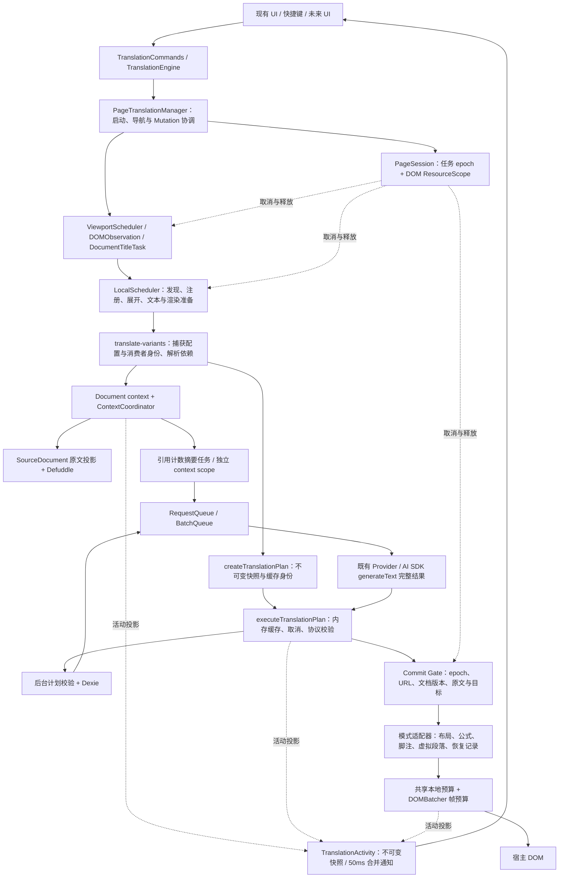

# 第二阶段翻译架构验收

本轮以 `6076134be8ed73367ae24d18f3260ad43f19e8a9` 为基础，保留第一阶段实现。最新上传指令要求仅本地提交，因此未推送、创建 PR、标签或 Release，未操作 GitHub Actions，未修改工作流。性能数据见 [PERFORMANCE.md](./PERFORMANCE.md)，初始差距见 [AUDIT.md](./AUDIT.md)。

## 架构与真实调用链



真实入口为 `PageTranslationManager.start()` → `observeTopLevelParagraphs()` → `walkAndLabelElementChunked()` → 段落注册/巨型段落拆分 → `ViewportScheduler` → 共享本地调度 → `translateWalkedElement()` → `translation-modes` → `translateTextForPage()` → 上下文依赖准备 → `translateTextCore()` → `createTranslationPlan()` → `executeTranslationPlan()` → `enqueueTranslateRequest` → 后台身份校验、缓存、既有队列和 Provider → 校验结果 → 模式的 Commit Gate → 布局与 DOM 提交。

核心不依赖 React、Toast 或 Manager。纯规划层只接收已经准备好的数据；存储、消息、DOM、Provider 和 UI 分别是外围适配器。`translation-config-feedback.ts` 接管具体 Toast 校验。依赖图契约测试递归检查规划、执行、状态、上下文协调与调度的运行时导入。

| 所有者                     | 权威状态和生命周期                                                                     | 边界                                                               |
| -------------------------- | -------------------------------------------------------------------------------------- | ------------------------------------------------------------------ |
| PageSession                | 当前任务 epoch、版本、配置副本、AbortSignal、DOM 资源注册                              | 导航替换任务 epoch，保留 DOM 观察与恢复资源；停止释放两者          |
| Document context           | URL、Document Revision、元数据、原文缓存、文档观察器、revision signal                  | 按文档存活，停止整页翻译后仍验证缓存；pagehide/导航释放            |
| ContextCoordinator         | pending 消费者、ready/cooldown/cancelled 条目                                          | 无消费者时取消底层任务；成功条目有容量与 5 分钟 TTL                |
| TranslationPlan            | 来源、模式、配置/正文/原文版本、Provider/语言/Prompt/术语/上下文/格式、scope、校验要求 | 不存运行中 Promise、DOM 或 UI；递归冻结；hash 不包含会话 ID        |
| LocalScheduler             | 双 FIFO Map、任务、预算、优先级与取消监听                                              | 一个页面本地执行所有者；前景四轮后给后台机会；不等待网络完成       |
| ViewportScheduler          | 原生 IntersectionObserver、boxless gate、pending WeakSet                               | 保留 display:contents、隐藏菜单、跨 ShadowRoot 与巨型单元判断      |
| DOMObservation             | root → MutationObserver 注册表                                                         | 去重、断开移除的根、停止清空；Manager 保留网站语义判断             |
| DocumentTitleTask          | 标题原文、观察器、请求版本、独立取消器、恢复信息                                       | 子任务 scope；关闭标题翻译不取消正文；使用同一提交有效性规则       |
| 渲染模式/translation-state | source region 快照、包装节点、交换与原文恢复记录                                       | 保留成熟布局/恢复算法；所有模式组合统一 Commit Gate                |
| DOMBatcher                 | 待提交写入与 RAF                                                                       | 每帧 4ms 协作预算、取消立即摘除任务；显式同步 flush 仅恢复/测试    |
| TranslationActivity        | 有界活动投影、计数、最后一项结构化错误、订阅者                                         | 不创建会话、不调度、不持有 DOM/文本/密钥，不成为第二个权威执行状态 |

`PageSession.documentRevision` 读取文档所有者的版本，不维护第二份计数。Source Region Revision 继续由节点/字符快照、虚拟段落 generation 和既有恢复状态表达；局部编辑不升级为整篇文档重提取。

## 生命周期与失效协议

| 变化                                             | 文档上下文                                   | 原文/渲染                                                |
| ------------------------------------------------ | -------------------------------------------- | -------------------------------------------------------- |
| main/article 追加、评论、无限滚动新增            | 复用当前正文与摘要                           | 只发现/翻译新增区域                                      |
| 局部段落编辑                                     | 不重提全文                                   | 原文快照失效；既有有界 retranslation 调度                |
| main/article/body 整体替换或替换主要直接源子节点 | 增加 Document Revision，取消旧 revision 订阅 | 拒绝旧结果，发现新正文                                   |
| SPA 路由切换                                     | 释放文档上下文、替换任务 epoch               | 保留既有 DOM 所有权；旧异步结果不得提交                  |
| 页内锚点                                         | 不失效                                       | 保持现有翻译                                             |
| 扩展包装、spinner、仅译文交换及恢复              | 排除扩展写入                                 | 使用既有 extension-driven 标记避免自触发循环             |
| 手动停止整页翻译                                 | 不清除独立消费者正在使用的上下文             | 取消页面任务、清空本地待执行项、断开会话观察器、恢复原文 |
| pagehide/真实文档离开                            | 取消文档所有者与共享任务                     | 释放文档资源                                             |

上下文协调状态为 `idle → pending → ready / cooldown / cancelled`。ready 到期或失效重新进入 pending；cooldown 到期再试；cancelled 是有界短期状态，下次有效请求可立即重建。活动 pending 不被容量淘汰。每位消费者独立退出，最后一位退出才取消 `context-*` 后台 scope；后台仍由可信 `sender.tab.id` 构建跨标签隔离作用域。后台 pending scope 使用引用计数并在 finally 移除。

上下文因正文替换失效时最多尝试三次，每次等待 100ms 安静窗口、最多等待 1,500ms；持续不稳定抛出可识别的 `CONTEXT_UNSTABLE`。没有增加“跳过必要上下文”的性能捷径；既有摘要网络失败后的显式可选回退保持不变。Defuddle、正文长度规则与 Prompt 文案保持不变。

输入翻译使用独立 request scope 和文档信号，不采用当前 PageSession 的取消信号。标题使用页面父信号加独立标题子信号。划词/自定义操作继续使用原有专用后台请求协议；它们不归整页 PageSession 所有，也不强制套用页面请求模型。既有全量回归覆盖这些路径。

## 规划、执行与提交契约

1. 来源入口捕获配置副本与会话；异步准备明确的上下文、语言和术语。
2. 纯函数生成完整计划并冻结 Provider、Prompt、术语和上下文快照。配置版本由现有配置所有者提供，WeakMap 只记录返回副本的版本元数据。
3. 执行器在内存命中前检查 lifetime，命中后仍验证 HTML marker/inline atom 协议；坏缓存移除。
4. 后台在 Dexie 查询前重算新协议计划身份，拒绝 payload/hash 不一致；兼容未携带新 planIdentity 的旧客户端。
5. RequestQueue/BatchQueue 继续控制网络并发、重试、批量及单项回退。没有引入第二个网络队列。
6. 取消立即拒绝本地执行 Promise，并传递后台 scope 取消；同一所有者/作用域的取消消息去重。迟到响应不写页面内存缓存。
7. 双语、仅译文、虚拟段落和标题组合相同 owner/URL/document/config gate 与各自原文/目标检查。配置存储的既有写入/监听路径发布页面翻译语义指纹；语言、Provider、Prompt、模式等变化会拒绝旧结果，标题开关等无关变化不使正文失效。已有已完成翻译不因此自动全页重译，新任务读取新配置。结果校验发生在进入渲染前，页面缓存命中同样走 gate。
8. 文本准备、结果拆解和布局进入共享本地预算；仅译文写入使用有预算的 DOMBatcher。双语装饰前后分别调度，保留装饰后的脚注行高与 Wikipedia float 测量。
9. 停止以既有恢复记录归还原始节点。DOM 被网站替换时丢弃旧恢复数据，避免把旧原文插回新内容。

预算是协作式的。单次 Defuddle parse、复杂布局测量、原子 DOM 操作和虚拟段落 materialization 无法被强制抢占；基准独立记录同步解析成本。背压通过 lazy generator、共享预算、视口门控和去重实现，不通过丢失段落或串行等待网络实现。

## UI 接口

公开类型位于 `src/utils/host/translate/engine-state.ts`：

```ts
interface TranslationCommands {
  readonly isActive: boolean
  start(): Promise<void>
  stop(options?: { userInitiated?: boolean }): void
}
interface TranslationEngine extends TranslationCommands {
  getSnapshot(): TranslationEngineSnapshot
  subscribe(listener: () => void): () => void
}
```

快照含 `sessionId`、`phase`、`pending.context/request/render`、`completedRequests`、`committedResults`、`failedTasks`、`cancelledTasks` 和 `lastIssue`。阶段为 idle/discovering/preparing-context/translating/rendering/settled/cancelled/error。错误包含分类、可重试标志和 Retry-After；网络内部重试仍由原队列负责，接口不虚构每次底层重试进度。

`progressScope: "observed-work"` 明确表示当前已发现/执行的工作。settled 不表示尚未滚入视口的整页已全部完成，取消任务数包括不同阶段的工作项，也不是独立段落总数。

```ts
// 实例由 host runtime 组装；未来 UI 只接收接口，不导入内部队列。
function attachStatus(
  engine: TranslationEngine,
  render: (state: TranslationEngineSnapshot) => void,
) {
  render(engine.getSnapshot())
  const unsubscribe = engine.subscribe(() => render(engine.getSnapshot()))
  return unsubscribe // UI 卸载时调用
}
// React 可使用 useSyncExternalStore(engine.subscribe, engine.getSnapshot)。
// 用户触发停止：engine.stop({ userInitiated: true })。
```

快照不可变，状态不变时对象引用稳定；通知以 50ms 合并，没有订阅者时不创建通知定时器，取消最后一个订阅者时移除定时器。旧 epoch 的完成事件不污染新会话。实际快捷键已改为依赖 `TranslationCommands`。未改 React 外观、设置、主题或用户行为。

## 清理与契约测试

移除了 Manager 自有 active/version 权威状态、停止时全局清空摘要、按 session 重复建立摘要 key、无界上下文循环、原始无预算 DOM 批次、请求核心的 Toast 依赖和 Manager 中的视口/观察器/标题所有权。既有文档/SourceDocument、网络队列、缓存和渲染恢复实现被复用，没有平行保留另一套相同职责的引擎。

| 缺陷/契约                                                                   | 主要测试                                            |
| --------------------------------------------------------------------------- | --------------------------------------------------- |
| 页面停止不取消输入，最后消费者才取消摘要，标题取消不影响正文                | `feature-context-lifetime.test.ts`                  |
| epoch 与 DOM lifetime 分离，异常清理继续执行                                | `session-resources.test.ts`                         |
| 同 URL 追加复用、主要正文替换失效、连续 mutation 有界等待                   | `webpage-context.test.ts`、`translate-text.test.ts` |
| 配置切换拒绝旧结果、标题开关不影响正文                                      | `config-commit-contract.test.ts`                    |
| 不可变快照、wire identity、协议拒绝、取消后不缓存、批量取消去重             | `prepared-plan.test.ts`                             |
| 实际上下文 → 计划 → 后台真实队列 → 模拟 Provider → 双语/仅译文 → 原节点恢复 | `pipeline-contract.test.ts`                         |
| URL/Document/Source gate、每帧写预算、停止立即释放写入                      | `render-contract.test.ts`                           |
| 30 个视口任务共享预算且网络并发、公平性、abort、yield 异常恢复              | `local-scheduler.test.ts`                           |
| 稳定 UI 查询、1,000 次变更一次通知、旧 epoch 隔离、错误分类                 | `engine-state.test.ts`                              |
| 跨标签取消、批量与回退快照、Provider 与 Prompt 一致性                       | 既有 `translation-queues.test.ts` 等后台集成回归    |
| 主文档/body 替换、Shadow DOM、boxless、原文改写、标题、恢复                 | 既有 Manager/渲染回归 + Chromium 兼容夹具           |
| Headless 运行时依赖和 SDK 重试归属                                          | `architecture.test.ts`                              |

契约测试保留真实计划、上下文协调、后台消息处理、RequestQueue/BatchQueue 和 DOM 模式。仅配置存储、数据库边界和 Provider 返回被替换；不冒充真实 MV3 消息传输或真实模型质量测试。

## 验证、限制与提交

最终命令、通过数量、浏览器原始记录和性能限制见 [PERFORMANCE.md](./PERFORMANCE.md)。真实 MV3 验收与 DOM 浏览器 harness 分开报告。未使用真实付费模型压测。

剩余限制：

- 任意站点 DOM 没有统一的“文章身份”。语义根/主要子节点替换规则覆盖本轮用例；在无 main/article 的复杂虚拟 feed 中，整窗替换与新文章仍可能需要站点策略。局部内容摘要有意保持到整篇失效或 TTL，不对每次字词编辑重提全文。
- 五分钟热上下文缓存保留一个文档观察器及有界源文本；它在手动停止后继续跟踪，属于支持输入任务和缓存有效性的明确文档资源，pagehide 才释放。短时 stop+GC 数据不能证明长期零泄漏。
- 合作式预算不保证任意原子操作小于预算；未为减少延迟降低摘要质量或迁移所有布局算法。
- 新 UI 接口面向页面翻译引擎。输入和划词专用展示协议保留，未来 UI 可在外围组合，不应把页面进度当作所有功能的总进度。
- 扩展环境策略阻断的真实 MV3 项目不能由模拟存储/消息的浏览器结果替代。

阶段提交：

| 阶段                   | 本地提交                             |
| ---------------------- | ------------------------------------ |
| 0 差距审计             | `2ef33979`                           |
| 1 生命周期/上下文      | `11f35542`                           |
| 2 不可变计划/执行      | `374eb54c`                           |
| 3 调度/渲染/DOM 所有权 | `5845167d`                           |
| 4 Headless UI 接口     | `23b7f400`                           |
| 5 回归/性能/工程清理   | 本报告所在最终验证提交，见 `git log` |

每阶段提交均带 `[skip ci]`，全部留在本地分支 `codex/translation-architecture-upgrade`。
