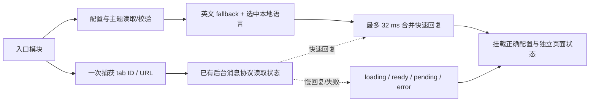
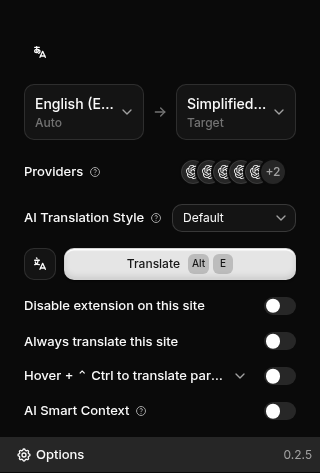
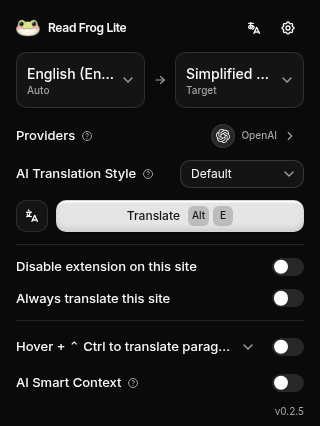
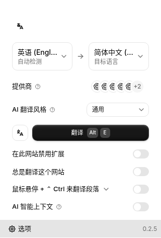
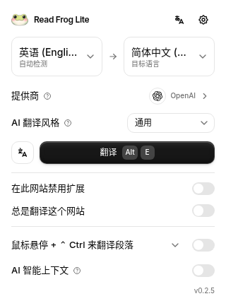

# Read Frog Lite 前端升级交付

本轮在 `codex/popup-ui-performance` 完成审计、Popup 启动/布局、组件收敛及完整页面优化，基于远程核对过的 `bb14e8bb`（`codex/translation-architecture-upgrade`），保留 React 19 和已有翻译引擎架构。按本轮附件仅本地提交：没有 push、PR、Release 或 GitHub Actions 操作，workflow 文件未改变。

## 结论与测量边界

- Popup 初始静态 JS 减少约 **45.2%**；常用中英文高度 **472 → 426 px**。十种 UI 语言、所有原有主要操作保留。
- 最终交替 A/B 测量中，四组正确可交互 P50 均改善约 **18%–20%**，并非靠先显示错误开关值。慢后台/失败有独立状态与重试，配置控件可先使用。
- **真实 MV3 未通过验收**：当前 Chromium 管理策略 `ExtensionInstallBlocklist=["*"]` 禁止未打包扩展，service worker 无法加载。以下是生产 HTML/JS + 受控浏览器 API 的实测，不是实测后台唤醒时间。没有调用付费模型；live free API 测试按 AGENTS.md 要求跳过。
- Node 24.19.0、Linux、Chromium 154.0.8037.57、320 px Popup。正常生产测量、production profiling build、CDP tracing 分开保存。测量时不并行构建/跑测试，宿主其他负载不可完全控制。

## Popup 启动结果

最终使用 30 个配对样本 × 4 条件 × 2 版本，共 240 次加载；逐样本交替 AB/BA 顺序，条件交错，不删异常值。cold 是新浏览器上下文，repeat 是同一上下文中新文档；不宣称操作系统磁盘冷缓存。模拟 storage 5 ms、tabs 15 ms、后台消息 10/120 ms。JS 主线程繁忙会推迟回调，因此 raw.json 同时记录真实回调等待时间。

下表每项为 P50 / P95，单位 ms。内容出现 = 主要配置控件 DOM 就绪；内容绘制 = 之后双 rAF 的上界，另存浏览器 FCP；正确可交互 = 当前页面状态已确认且翻译按钮可用。

| 条件            |             内容 DOM：前 → 后 |         内容绘制上界：前 → 后 |           正确可交互：前 → 后 | 可交互 P50 改善 |
| --------------- | ----------------------------: | ----------------------------: | ----------------------------: | --------------: |
| cold / 10 ms    | 392.7 / 443.8 → 315.2 / 410.2 | 451.4 / 509.6 → 382.1 / 475.8 | 392.8 / 443.9 → 315.2 / 410.3 |           19.8% |
| cold / 120 ms   | 493.3 / 545.7 → 331.4 / 366.2 | 545.3 / 598.9 → 391.0 / 422.2 | 493.4 / 545.9 → 400.2 / 434.2 |           18.9% |
| repeat / 10 ms  | 374.0 / 425.0 → 303.8 / 333.0 | 432.1 / 474.9 → 368.0 / 424.3 | 374.1 / 425.1 → 303.8 / 333.0 |           18.8% |
| repeat / 120 ms | 473.2 / 497.2 → 315.1 / 376.0 | 528.3 / 554.6 → 378.3 / 448.0 | 473.4 / 497.3 → 386.7 / 457.8 |           18.3% |

正常生产 ScriptDuration 的全部样本中位数 **196.6 → 174.5 ms**。堆用量中位数 **10.28 → 9.74 MB**。每次加载后关闭页面并断言 context 中无遗留页面；重复打开未观察到每次递增的页面堆占用。它不是整个浏览器进程的长时泄漏证明。最大观察 CLS 为 0.0001 → 0.0003。默认英文场景实际只请求一个 Inter Latin woff2（48,256 B），没有把打包的所有字体误算为首屏加载。

[最终配对数据](paired/raw.json) · [汇总](paired/summary.json) · [初始基线](baseline/summary.json) · [较大波动的非配对复测](after-unpaired/summary.json) · [调度收敛前的配对结果](paired-before-coalescing/summary.json)。保留后两者说明为什么不能只选较快的一轮。

## 根因、调用链与修复

旧链路：全量模块加载 → 并行 config/theme/tabs → i18n → 后台状态 → 第二次 tabs 查询 → React mount。后台超时会让整页空白；点击翻译还会重新查询 tab，并在后台只确认转发时乐观宣告启停。

新链路：



最后配对测量发现：直接挂载重 UI 会占住主线程，连已近返回的快消息也延后约一个渲染周期。32 ms 是首帧合并的**硬预算**，快回复可进入首帧；慢/挂起消息不会让配置控件等满 2.5 s RPC 超时。未知页面状态始终禁用翻译操作，不使用错误的 false 当成就绪值。配置读取失败显示原生重试界面，不挂载可编辑默认配置。

Popup adapter 只调用原有后台协议、订阅该 tab 的状态存储变更；没有复制 TranslationEngine、队列或请求执行器。命令应答仅代表转发，之后有界读取真实启停结果；重复点击被 pending 阻止，晚到响应受 revision 保护，关闭时停止轮询并解除状态监听。站点黑白名单/自动翻译从当前配置与捕获 URL 派生，外部配置同步后不会保留旧布尔值。Popup 直接 tabs.query 从启动 2 次降为 1 次，后续控件使用捕获对象；后台语言检测自己的查询不包含在这个计数中。

## 初始资源与入口图

最终文件的传递静态 JS、HTML modulepreload 和 CSS 字节（未压缩；扩展实际读本地文件）：

| 入口            |         JS B：前 → 后 |  减少 |    CSS B：前 → 后 |
| --------------- | --------------------: | ----: | ----------------: |
| popup           |   1,802,425 → 988,176 | 45.2% | 207,137 → 206,833 |
| options         | 1,612,250 → 1,027,827 | 36.2% | 207,077 → 206,773 |
| translation-hub | 2,995,886 → 1,187,718 | 60.4% | 207,053 → 206,749 |

[最终资源清单](after-bundles.json) · [原清单](baseline-bundles.json) · [完整模块图/归因](module-graph.json)。归因图的 module.renderedLength 是构建器在最终压缩前的分配值，不与最终文件字节相加。最大变化是 locale 归因约 600 KB → 80 KB、Motion 从 Popup 初始图退出；React、Base UI 是仍然需要的交互基础，未假装因模块文件名叫 storage 就把整个成本算为存储。

- HTML UI 只先加载 en 与选中语言；其他语言是包内本地 chunk，切换完成后才更新语言，较老请求不能覆盖新选择。所有十种语言均有生产页面截图；插值、英文 fallback、字面模板 token 和失败重试有测试。
- MV3 worker/content 保持同步语言 bundle，background.js 无动态 import；manifest 与基点完全一致。没有新增 host 权限、扩展 ID、存储格式或迁移。
- Provider 面板按需加载，pointer/focus 预热。曾发现 Suspense 把首次呈现延后约 315 ms，最终改为资源就绪直接更新组件，保留错误重试。
- Options 的实际首页资源也测了：首个样本已完成的 JS 请求约 **3,698,183 → 1,332,863 B**。连接测试服务只在用户点击时加载，未展开的高级 JSON 编辑器不挂载；CodeMirror 仍按编辑器需求加载。静态图不是完整首页资源的替代指标。
- Hub 把翻译执行模块移到真实请求，把语言检测移到非空自动源语言输入；取消、文本变化及卸载会忽略旧检测结果。总扩展包约 14.79 MB，主要收益是首屏加载成本，不声称总包同幅缩小。

## 首次交互、完整页面及取舍

正常生产、各 30 次；下表是 DOM click 分发至内容可用/反馈，不含 Playwright actionability 等待或真实显示器延迟。抽屉故意不触发 hover/focus 预热。

| 交互                            | 前 P50 / P95 ms | 后 P50 / P95 ms |
| ------------------------------- | --------------: | --------------: |
| Provider 抽屉首次可用（无预热） |     40.8 / 52.3 |     62.5 / 74.4 |
| 语言菜单首次可用                |   106.6 / 125.7 |   108.9 / 138.5 |
| 开关反馈                        |     11.0 / 17.7 |       5.9 / 7.7 |
| 翻译按钮首次反馈                |     17.1 / 18.9 |       1.5 / 1.9 |

抽屉无预热首次增加约 22 ms，P95 仍低于 75 ms；这项成本没有藏起来。正常 pointer/focus 可提前预热。语言菜单没有明确改善，保留其搜索与键盘语义。翻译按钮的新版反馈是明确 pending，随后确认真实结果；旧版是查询 tab 后乐观改文字，不能把二者都当成后台完成时间。

| 页面/路由（30 次）      | 前 P50 / P95 ms | 后 P50 / P95 ms |
| ----------------------- | --------------: | --------------: |
| options / ready         |   656.1 / 720.9 |   610.7 / 686.0 |
| options / editorRoute   |   150.2 / 175.0 |   184.6 / 233.8 |
| options / backRoute     |    92.4 / 104.1 |    76.4 / 103.6 |
| translation-hub / ready |   405.5 / 452.2 |   348.1 / 403.2 |

Options 的 ready 要求 API Provider 页面和 API Key 输入出现，Hub 要求编辑框出现。首次 CSS 编辑器路由增加约 34 ms（P95 也增大），代价来自将 CodeMirror 从首页移到首次需要它时加载；返回已加载设置页更快。没有隐藏编辑器功能或丢掉 autosave 草稿。高级折叠区首次打开后持续保留 draft，关闭再打开仍保存不完整 JSON。

## Profiler、解析与主线程证据

独立 production profiling build 各 5 次，与上方正常生产计时不混算。模块就绪中位数 222.0 → 190.9 ms；首次 Root actualDuration 61.6 → 61.7 ms。没有声称 React mount 获得与资源体积相同幅度的收益。语言控件/Base UI 初始化仍是 mount 的主要成本之一。

切换 AI 上下文时，Provider 摘要更新 commit 在 5 次样本中由每次 1 次变为 0 次；其订阅改为 Provider 配置与分配 ID 投影。没有普遍加 React.memo。configAtom 的 mount 重读承担订阅/写入竞态保护，保留既有串行写队列与同步语义；这次没有为省一次 Zod 验证冒险删掉它。

初次配置读取（含 fixture 延迟、校验和复制）中位数 24.9 → 17.4 ms；其中 Zod 17.9 → 10.1 ms；i18n.init 1.7 → 1.6 ms。全量 locale 的解析/转换发生在 init 前的模块阶段，不能拿 init 的短耗时否认资源成本。

CDP Tracing 另各 5 次，原始 gzip trace 解压后可导入 DevTools。下表是事件族 inclusive 时长中位数，含追踪开销，多线程及嵌套事件可能重叠，**不可相加当总启动时间**：

| 事件族                      | 前 ms | 后 ms |
| --------------------------- | ----: | ----: |
| V8.ParseProgram             |  38.6 |  28.0 |
| V8.CompileCode              |  68.7 |  61.3 |
| v8.parseOnBackgroundParsing | 250.0 | 162.8 |
| FunctionCall                |  94.5 |  90.4 |

[Profiler 前](profile-before/profiles.json) · [Profiler 后](profile-after/profiles.json) · [Trace 前](trace-before/summary.json) · [Trace 后](trace-after/summary.json)。下载/资源读取在 paired/raw.json 的 resource timing，后台/浏览器 API 在 calls，render/commit 在 profiles 与 commits，FCP/字体/CLS 均单列。

## UI 与状态收敛

顶部品牌、Hub、设置并排；删除账号空节点与过时说明。源/目标语言保持直接选择，Provider 图标去重并显示名称，功能分配仍在抽屉完整列出。主翻译动作与网站开关分组；快捷键、风格、翻译模式、AI 上下文均保留。使用现有 Tailwind token、Base UI，补齐可访问名称、抽屉标题/说明、Escape 焦点恢复。Switch 保留指针捕获与拖拽、键盘、disabled/readOnly/controlled 行为，普通短过渡用 CSS；Drawer 改为 150 ms，并遵守 reduced motion。

| 优化前                                             | 优化后                                            |
| -------------------------------------------------- | ------------------------------------------------- |
|          |          |
|  |  |

完整状态见 [视觉结果](visual-after/results.json)：25 个静态场景 + 交互项，包含深浅色/中英文、全部 UI 语言、长标签、多/无可用 Provider、限制页、缺 tab、storage/message/tabs 错误、超时、loading、已翻译页，以及 1.25/1.5 deviceScaleFactor。后者是设备显示比例，不冒充真实浏览器 zoom。交互还在与内容等高的 320×426 px 视口复核弹层滚动和控件可达性。常用中英文 426 px，最长语言样本 445 px，无横向溢出。存储启动错误有独立 74 px 恢复界面。

## 技术栈与框架选择

保留 React 19。没有迁移到 Preact、Solid 或 Svelte，也没有安装新框架。测量证明主要可削减成本是语言资源、等待链、服务执行与动画库；没有本项目候选框架的兼容实验，因此不编造候选框架的毫秒/体积数字。Preact compat 仍需验证 Base UI/Jotai/TanStack/Router/Motion；Solid/Svelte 会重写 hooks/组件与交互基础，净收益未被证明。WXT/MV3 一般可构建这些框架，不等于当前生态能无成本迁移。

| 工具/范围                               | 结论与实际使用者                                                                                                                      |
| --------------------------------------- | ------------------------------------------------------------------------------------------------------------------------------------- |
| React / WXT / Vite / Tailwind / Base UI | 保留统一基础与 token；不增加第二套交互库                                                                                              |
| Jotai                                   | 可编辑配置与 UI 投影；引擎状态仍归原 headless owner                                                                                   |
| TanStack Query                          | 保留异步服务与 mutation；Popup RecoveryFallback → useExportConfig 确实使用 mutation，因此 QueryClientProvider 不是无用空层            |
| TanStack Form / Store                   | Options 表单与细粒度订阅，保留 autosave 生命周期                                                                                      |
| React Router                            | 完整页面路由保留；Popup 不建 Router；共享 API Key 警告的 Router context/link 代码位于延后加载的 Provider 面板，可作为后续进一步隔离点 |
| Motion / CSS                            | 普通 Switch 移除 Motion 导入；复杂 slider/color picker 仍保留 Motion                                                                  |
| Iconify / Tabler / Remix                | 自定义动作离线 Iconify、固定新 UI 命名 Tabler，保留有实际调用的存量图标；不为统一包名重写全站                                         |
| CodeMirror                              | 保留 JSON/CSS 编辑器与 peer/dedupe 依赖，初次可见时加载                                                                               |
| Lexical                                 | 输入适配器类型与测试依赖，保留 devDependency；不是 Options 自有编辑器                                                                 |
| shadcn / cn                             | 分别提供 theme.css 中真实导入的 tailwind.css、styles/utils 的 class 合并，均保留                                                      |
| 划词/输入/字幕/浮动 UI                  | 保留宿主生命周期和原引擎；共享 Switch 改动已回归，不重写这些入口的业务                                                                |

没有删除 package.json 依赖，因为逐项查证后未发现可安全删除的直接依赖；删除的是无用节点、重复状态/查询与不必要的初始模块导入。[详细只读审计](AUDIT.md) · [共享 UI 约定](UI-CONVENTIONS.md)。

## 验证、剩余限制与复现

- 全量 Vitest：290 文件 / 2703 用例通过；最终启动调度收敛后，Popup/i18n/共享开关/Options 定向 13 文件 / 45 项通过。新增 locale 插值断言另复测。SKIP_FREE_API=true，不代表真实外部服务验证。
- 类型/静态 lint、格式检查和生产构建通过。manifest 与基点逐字段一致；workflow 无改动；background 不含动态 import。
- 生产浏览器检查：翻译启停确认、语言/Provider/风格/模式持久化、站点自动翻译与禁用、外部配置同步、主题同步、鼠标拖拽只产生一次写入、reduced motion、可访问名称、键盘焦点恢复、错误重试，见 [功能结果](functional/results.json)。不使用真实模型。
- 尚待真实允许扩展的 Chromium：原生 Popup 生命周期、真实 SW 冷/热唤醒、真实跨上下文通知、native zoom、音频/字幕/输入注入端到端验收。现有相关单元测试通过，但不能替代上述验收。
- 后续 P2：配置校验/重读、语言控件 mount、全局约 207 KB CSS、Provider 面板 Router context 隔离、content/worker 全语言包。应继续以相同场景测量，当前没有证据支持整站换框架。

在仓库根目录复现（不需要 GitHub Actions）：

```sh
./node_modules/.bin/wxt build
node e2e/ui-harness/prepare.mjs
# BEFORE 是以 bb14e8bb 构建且保留的生产目录
node e2e/ui-harness/paired.mjs "$BEFORE" .output/chrome-mv3 /tmp/ui-paired
node e2e/ui-harness/interactions.mjs .output/chrome-mv3 /tmp/ui-interactions
node e2e/ui-harness/pages.mjs .output/chrome-mv3 /tmp/ui-pages
node e2e/ui-harness/visual.mjs .output/chrome-mv3 /tmp/ui-visual
node e2e/ui-harness/functional.mjs .output/chrome-mv3 /tmp/ui-functional
node e2e/ui-harness/trace.mjs .output/chrome-mv3 /tmp/ui-trace
node e2e/ui-harness/build-diagnostics.mjs . /tmp/ui-profile
node e2e/ui-harness/profile.mjs /tmp/ui-profile/chrome-mv3 /tmp/ui-profiles
SKIP_FREE_API=true ./node_modules/.bin/vitest run
./node_modules/.bin/oxlint --type-aware --type-check
./node_modules/.bin/oxfmt --check .
```

Graph-only 构建使用 `UI_PROFILE=0 node e2e/ui-harness/build-diagnostics.mjs SOURCE OUTPUT`；两版 graph-html.json 传给 graph-report.mjs。诊断脚本使用独立 outDir，不覆盖正常生产产物，临时 config 会移除。页面 API fixture、trace/profiler 插桩只在 e2e 工具中，不进入发布包。

阶段提交：`0c85d693` 审计基线、`bc7d7a6a` 启动/语言拆分、`fdc96b7b` 排版与语义、`02e8b20c` 共享交互收敛、`7c77d7ce` 完整页面优化，最后一笔为测量发现的调度/抽屉/连接测试收敛与交付证据。每阶段均可本地回退。
